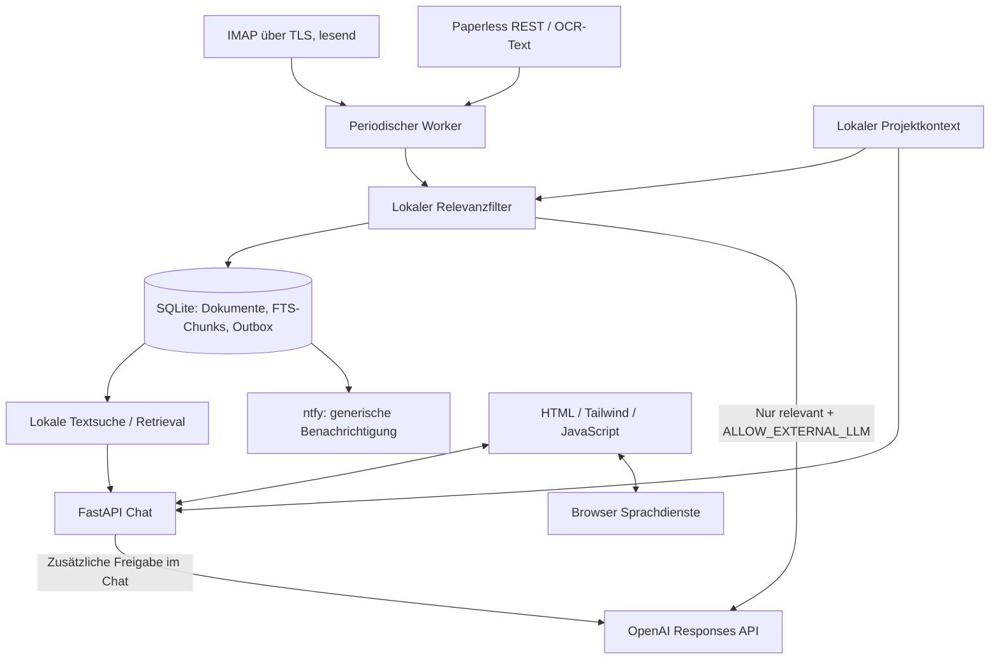

# Lokaler KI-Butler

FastAPI-Grundgerüst mit deutscher HTML/Tailwind/JS-Oberfläche, Sprachsteuerung, lokalem Retrieval, IMAP-/Paperless-Monitoring und ntfy-Outbox. Ohne API-Schlüssel im lokalen Suchmodus nutzbar. OpenAI und Gemini sind als externe Anbieter implementiert.

## Start

Python 3.11+ und für CSS-Änderungen Node.js 20+.

```sh
python3 -m venv .venv
source .venv/bin/activate
pip install -r requirements.txt
cp .env.example .env
python -c 'import secrets; print(secrets.token_urlsafe(32))'
# Ausgabe als API_TOKEN in .env eintragen
uvicorn backend.main:app --host 127.0.0.1 --port 8010 --workers 1 --no-proxy-headers
```

[Oberfläche öffnen](http://127.0.0.1:8010). Die lokale Oberfläche meldet sich automatisch an; der interne API-Token muss dort nicht eingegeben werden. Verbindungen und Zugangsdaten können pro Dienst in den Einstellungen gespeichert werden. Projekte im Kontext-Editor speichern. Die Oberfläche und CSS-Dateien werden lokal ausgeliefert; kein Tailwind-CDN.

```sh
cd frontend
npm ci
npm run build
```

## Projektstruktur

```text
backend/
  main.py           FastAPI, Auth, Chat, Kontext, statische Oberfläche
  config.py         Umgebungsvariablen und Validierung
  sources.py        IMAP TLS/UIDVALIDITY, Paperless-Paginierung
  store.py          SQLite, FTS5-Chunks, Kontext, Ereignisse/Outbox
  intelligence.py   Lokaler Relevanzfilter, externe OpenAI-Analyse
  worker.py         Periodische Verarbeitung, Fehlerisolation, ntfy
frontend/
  index.html        Chat, Fundstücke, Kontext, Verbindung
  app.js            API-Aufrufe, Speech Recognition/Synthesis
  style.css         Responsives Layout
  tailwind.*        Lokaler CSS-Build
 tests/test_butler.py
 data/              Lokale SQLite-Daten, nicht versioniert
 .env.example       Konfigurationsvorlage ohne Zugangsdaten
```

## Architektur und Datenfluss



Ein einzelner Uvicorn-Prozess startet den Worker im FastAPI-Lifespan und beendet ihn kontrolliert. Blockierendes IMAP läuft im Thread. Ein Lock verhindert überlappende Scans. Jeder Eintrag wird erst nach erfolgreicher Analyse atomar mit seinen Chunks und ggf. einer Benachrichtigung gespeichert. Fehlgeschlagene Analysen werden beim nächsten Abruf erneut versucht; andere Einträge und Quellen laufen weiter. Die Status-API und Oberfläche zeigen Quellenfehler. ntfy wird aus einer persistenten Outbox versorgt (at least once: nach einem Absturz zwischen Versand und Bestätigung sind Duplikate möglich).

IMAP verwendet `BODY.PEEK[]` und einen read-only Ordner. IDs enthalten Account-Fingerprint, UIDVALIDITY und UID. Standardmäßig wird ein gleitendes 30-Tage-Fenster geprüft, einschließlich bereits gelesener Mails. Ältere Nachrichten sind außerhalb dieses Fensters. Das Grundgerüst liest bei jedem Scan dieses Fenster erneut; für große Postfächer sind persistente UID-Cursor und serverseitige Größenlimits sinnvolle Erweiterungen. Anhänge werden nicht analysiert. HTML-only-Mails bleiben inerte Daten und werden niemals als HTML dargestellt.

Paperless ruft alle Dokumentseiten ab und vergleicht Titel-/Inhalt-Hashes. Geänderte Dokumente ersetzen alte Chunks. Der erste Scan importiert auch den Altbestand und kann Fundstücke auslösen. Löschungen im Ursprung werden noch nicht synchronisiert. OCR übernimmt Paperless; diese Anwendung lädt keine PDF-Dateien herunter.

## Relevanz und Kontext

Beispiel im Editor:

```json
{
  "projects": [
    {
      "name": "Heizungswartung",
      "keywords": ["Heizung", "Wartung", "Heizungsbau Müller"],
      "active": true,
      "notes": "Termin im November geplant. Rechnung und Leistungsdatum vergleichen."
    }
  ]
}
```

`X-Spam-Flag: YES` wird ignoriert. Werbung wird über `List-Unsubscribe` und typische Begriffe erkannt und nur bei einem Treffer in aktiven Projekt-Schlüsselwörtern gemeldet. Rechnungen, Mahnungen, Fristen und Wartungen werden auch ohne Projekttreffer berücksichtigt. Das sind nachvollziehbare Heuristiken, keine zuverlässige Spam-Klassifikation. Falschpositive und übersehene Werbung sind möglich. Mit externer Freigabe erklärt das LLM die vorausgewählten Vorgänge anhand des Kontexts und verwandter lokaler Fundstellen; es kann die lokale Sperre für irrelevante Werbung nicht umgehen. Spam und irrelevante Werbung werden lokal indexiert, aber nicht proaktiv gemeldet; bei expliziter Chatfreigabe können passende Fundstellen extern übertragen werden.

RAG ist hier **lexikalisch mit SQLite FTS5** umgesetzt: überlappende 1.200-Zeichen-Chunks, bis zu fünf Fundstellen, Quellen-IDs im Chat. Ohne KI werden diese Auszüge direkt angezeigt. Für semantisches Retrieval kann `Store.search()` durch lokales ChromaDB plus lokal betriebenes mehrsprachiges Embedding-Modell ersetzt werden. Keine Cloud-Embeddings, keine automatischen Modelldownloads. Die Wartung-/Rechnungszuordnung ist eine kontextgestützte Analyse, kein beweissicherer Abgleich von Vertrags- und Rechnungspositionen.

## Datenschutz und Grenzen

- Standard: `ALLOW_EXTERNAL_LLM=false`. Datenbank, Volltextindex und Kontext sind lokal; keine Inhaltsprotokollierung und keine ausgehenden LLM-Aufrufe.
- Externe Analyse: `ALLOW_EXTERNAL_LLM=true`, `LLM_API_KEY` und `LLM_MODEL` setzen. Das Modell muss die Responses API unterstützen. Der Worker sendet dann pro relevantem Vorgang bis zu 4.000 Zeichen Inhalt, Titel, Projektkontext und bis zu fünf verwandte Auszüge. Chat benötigt zusätzlich die Checkbox; dabei werden Frage, Kontext und Fundstellen übertragen. Freigabe ist keine Anonymisierung.
- OpenAI erhält `store:false`. API-Daten werden laut Anbieter standardmäßig nicht für Training verwendet, solange kein Opt-in vorliegt. `store:false` garantiert **keine Zero Data Retention**; Aufbewahrung für Missbrauchsüberwachung und weitere Ausnahmen können gelten. Account-Einstellungen und Verträge bleiben maßgeblich: [offizielle OpenAI Data Controls](https://developers.openai.com/api/docs/guides/your-data).
- ntfy ist optional und erhält bewusst nur einen generischen Hinweis. Für vollständige Datenkontrolle eine eigene ntfy-Instanz verwenden.
- Spracherkennung fordert lokale Verarbeitung an, wenn die Browser-API sie anbietet. Fehlt diese Möglichkeit, ist eine separate Bestätigung erforderlich. Lokale Sprachpakete und Browserunterstützung sind nicht garantiert. Vorlesen verwendet ausschließlich als lokal gemeldete deutsche Stimmen. [MDN: lokale Spracherkennung](https://developer.mozilla.org/en-US/docs/Web/API/SpeechRecognition/processLocally).
- Dokumentdaten gelten im Prompt als untrusted; LLM-Ausgaben werden nur als Text angezeigt. Es existieren keine LLM-Tools für Versand, Zahlungen oder Schreibzugriffe auf Quellen.
- SQLite ist nicht verschlüsselt. Betriebssystem-Verschlüsselung und Dateirechte nutzen; `.env`, `data/` und Backups schützen. Keine öffentliche Bereitstellung: Loopback, Bearer-Token, Host-Prüfung, keine CORS-Freigabe. Für LAN-/Mehrbenutzerbetrieb braucht es TLS, belastbare Benutzer-Auth und Betriebsabsicherung.
- Kein autonomer Mailversand. Keine Hintergrundverarbeitung bei ausgeschaltetem Rechner. Für Dauerbetrieb den Startbefehl als systemd-/launchd-Dienst einrichten und nur einen Worker betreiben.

## API

Alle `/api/*`-Routen benötigen `Authorization: Bearer <API_TOKEN>`, außer dem separat abgesicherten Messenger-Platzhalter.

| Route | Zweck |
|---|---|
| `GET /api/status` | Worker, Quellenfehler, Freigabe |
| `GET/PUT /api/context` | Validierte Projektablage |
| `GET /api/events` | Letzte 100 relevante Vorgänge |
| `POST /api/scan` | Manueller Durchlauf |
| `POST /api/chat` | `{"message":"…","share_external":false}` |
| `POST /api/webhooks/messenger` | Deaktivierter Adapter-Platzhalter |

Der Messenger-Endpunkt akzeptiert ohne `MESSENGER_SECRET` nichts und liefert auch mit korrektem `X-Webhook-Secret` bewusst `501`. Für WhatsApp/Facebook müssen Anbieter-Challenge, echte Signaturprüfung, Deduplizierung und Versandadapter implementiert werden; der Platzhalter behauptet keinen erfolgreichen Empfang.

[Paperless REST-Dokumentation](https://docs.paperless-ngx.com/api/).

## Prüfen

```sh
source .venv/bin/activate
python -m pytest -q
node --check frontend/app.js
```

Tests verwenden ausschließlich temporäre lokale Daten und keine echten Accounts. Abhängigkeiten sind über Versionsbereiche beschränkt; für einen produktiven Einsatz einen geprüften Python-Lockfile ergänzen. Echte IMAP-, Paperless-, ntfy- und OpenAI-Verbindungen sowie die Mikrofonfreigabe müssen mit eigenen Zugangsdaten im Zielsystem geprüft werden.

## Einrichtung in der Oberfläche

Unter **Verbindungen** lassen sich Gemini/OpenAI, IMAP, Paperless und ntfy konfigurieren. Nach Anmeldung mit dem lokalen API-Token werden Einstellungen über die geschützte API in `.env` gespeichert (Dateirechte 0600) und sofort übernommen. Schlüssel sind über die API nur schreibbar; ein leeres Feld behält einen vorhandenen Schlüssel. Zum Entfernen eines Schlüssels derzeit den betreffenden Wert in `.env` löschen und den Server neu starten. Modell-IDs entsprechend dem eigenen Anbieterzugang eintragen. Die Schaltflächen testen gespeicherte Einstellungen; der KI-Test sendet lediglich einen generischen Testprompt und kann API-Kosten verursachen.

Gemini ist über `generateContent` angebunden. Vor Verarbeitung sensibler Daten werden eine geeignete Abrechnungs-/Vertragskonfiguration und eine ausdrückliche Bestätigung verlangt. Dies prüft den tatsächlichen Tarif nicht technisch. [Gemini-Bedingungen](https://ai.google.dev/gemini-api/terms). Der Internettest ruft example.com auf; er implementiert keine Websuche. WhatsApp/Facebook bleiben Erweiterungspunkte.

### Getrennte Verbindungskarten und Modellliste

Jede Verbindung besitzt eine eigene Karte mit Speichern, Testen und Status. Die Oberfläche speichert ausschließlich die Felder dieser Verbindung (`PUT /api/connections/{llm|imap|paperless|ntfy}`); Entwürfe in anderen Karten bleiben erhalten. Ungespeicherte Änderungen müssen vor dem Verbindungstest gespeichert werden. Der explizite KI-Test ist auch ohne Freigabe des Hintergrund-Monitorings möglich und sendet ausschließlich einen Testprompt. Der ntfy-Test verschickt eine generische Testnachricht.

Nach Eingabe des KI-Schlüssels lädt die Oberfläche die Modellliste automatisch mit kurzer Verzögerung. `POST /api/connections/llm/models` verwendet den gerade eingegebenen oder den gespeicherten Schlüssel desselben Anbieters, ohne den Entwurf zu speichern. Ein Anbieterwechsel erfordert einen passenden neuen Schlüssel. Gemini-Ergebnisse werden paginiert und auf `generateContent` gefiltert. OpenAI liefert die für den Schlüssel sichtbaren Modelle; die Liste enthält keine verlässliche Angabe zur Responses-/Text-Kompatibilität, daher ist anschließend der KI-Verbindungstest maßgeblich.

Referenzen: [Gemini models.list](https://ai.google.dev/api/models), [OpenAI models.list](https://developers.openai.com/api/reference/resources/models/methods/list).

### Anmeldung merken

Die Oberfläche merkt die lokale Anmeldung für 30 Tage mit einem signierten HttpOnly-/SameSite-Strict-Cookie. Nach Neuladen oder Serverneustart werden Verbindungseinstellungen automatisch geladen. Der lokale API-Token wird nicht im JavaScript-Speicher oder localStorage dauerhaft abgelegt. Schreibzugriffe mit Cookie benötigen die passende Origin. „Abmelden“ entfernt das Cookie; Änderung des API-Tokens invalidiert bestehende Sitzungen. Über HTTPS ist das Cookie zusätzlich Secure; der lokale HTTP-Testbetrieb bleibt ausschließlich an Loopback gebunden. Browserprofile und `localhost`/`127.0.0.1` besitzen getrennte Cookies. Gespeicherte Dienstschlüssel bleiben maskiert und müssen bei leeren Feldern nicht erneut eingegeben werden.

## ioBroker / Smart Home

Die eigene Verbindungskarte unterstützt **Simple-API** (typisch Port 8087) und **REST-API** (typisch Port 8093), optional mit Basic-Login oder Bearer-Token. Die Admin-Oberfläche auf Port 8081 ist keine Zustands-API. Eine Web-Erweiterung oder ein Reverse-Proxy kann über einen Basis-Pfad in der URL angesprochen werden. Passwort und Token sind über die Butler-API nur schreibbar. Es existiert kein Schalt-/Schreibzugriff auf ioBroker.

In „Datenpunkt-Muster“ werden bis zu zehn kommagetrennte Muster hinterlegt. Standard sind `*.connected,*.reachable,*.online,*.UNREACH`. Zusätzliche Muster wie `zigbee.0.*.temperature` liefern Messwerte. `*.alive` ist optional: Es beschreibt den Adapterbetrieb, nicht zwingend die Erreichbarkeit eines Geräts. Zustände stammen aus `GET /states?pattern=…` (Simple) oder `GET /v1/states?filter=…` (REST). Ein Test liest nur; „Zustände jetzt abrufen“ aktualisiert den lokalen Stand auch bei ausgeschaltetem Hintergrundmonitoring.

Der laufende Worker prüft bei aktivierter Verbindung im gemeinsamen Intervall (`POLL_SECONDS`, standardmäßig 300 Sekunden). Letzte Werte, Zeitstempel und Übergänge bleiben in SQLite gespeichert. Der erste Abruf bildet eine stille Ausgangsbasis. Anschließend erzeugen Wechsel zu offline, fehlenden Datenpunkten und Wiedererreichbarkeit lokale Fundstücke und ggf. generische ntfy-Hinweise. Fortlaufend identische Zustände erzeugen keine weiteren Meldungen. Ein Ausfall der ioBroker-API erhält den bisherigen Stand und meldet den Abruffehler, statt alle Geräte als verschwunden zu deklarieren. Ein geänderter URL-/Benutzer-/Musterbereich erhält einen eigenen Ausgangsstand.

**Bedeutung:** Nur bekannte Erreichbarkeitssuffixe (`connected`, `reachable`, `online`, `alive`, invertiert `UNREACH`/`unreachable`) werden als Online-/Offline-Indikatoren interpretiert. Nullwerte und fehlerhafte Qualitätsflags sind unbekannt; ein ausgeschalteter Verbraucher ist ein Messwert, kein Offline-Gerät. Ein zuvor gelieferter Datenpunkt, der in einer erfolgreichen vollständigen Musterabfrage fehlt, wird als „Datenpunkt fehlt“ angezeigt. Das beweist weder physische Abwesenheit noch eine Löschung des Geräteobjekts. Der jüngste ioBroker-Wert kann bereits alt sein: Zeitstempel und letzter Abruf sind sichtbar, keine Echtzeitgarantie. Bei geänderten ioBroker-Leserechten kann „fehlt“ auch „nicht mehr sichtbar“ bedeuten. Es werden Datenpunkte angezeigt, nicht eindeutig deduplizierte physische Geräte.

Die Übersicht ist filterbar und zeigt maximal 100 Treffer auf einmal; der vollständige gespeicherte Stand bleibt lokal. Es werden maximal 10.000 Punkte pro Abruf akzeptiert. Neue/verschwundene Datenpunkte werden innerhalb des gewählten Musterbereichs erkannt. Smart-Home-Daten lösen keine externen KI-Aufrufe aus. Im Chat werden passende gespeicherte Zustände (maximal 30) als lokale Quelle genutzt; eine externe Übertragung erfordert die bestehende ausdrückliche Chatfreigabe. IDs mit erkennbaren Geheimnis-Begriffen werden vom Import ausgeschlossen; dennoch Muster bewusst eingrenzen und keine sensitiven Freitext-/Credential-Datenpunkte auswählen.

API: `GET /api/connections/iobroker/states`, `POST /api/connections/iobroker/refresh`, `PUT /api/connections/iobroker`, `POST /api/connections/iobroker/test`.

Adapterdokumentation: [ioBroker Simple-API](https://github.com/ioBroker/ioBroker.simple-api), [ioBroker REST-API](https://github.com/ioBroker/ioBroker.rest-api).

### Lokaler Desktopbetrieb ohne Token-Eingabe

Die Browseroberfläche verbindet sich jetzt automatisch über `POST /api/session/local`. Dafür sind ausschließlich eine Loopback-Verbindung, Host `localhost`/`127.0.0.1` und eine übereinstimmende Origin erlaubt; fremde Webseiten und Netzwerk-Clients werden abgewiesen. Der lokale API-Token bleibt intern für API-Clients und Sitzungssignaturen bestehen, muss in der Oberfläche aber nicht eingegeben werden. Die automatische Verbindung vertraut Benutzern und Anwendungen auf diesem Rechner. Den Dienst ausschließlich an Loopback binden und ohne vertrauende Proxy-Header starten (`--no-proxy-headers`); nicht über einen öffentlichen Reverse-Proxy exponieren. Die vorigen Hinweise zur manuellen Browseranmeldung sind damit überholt.

### Präzisere Dokumentenfragen

Die Chat-Suche entfernt deutsche Frage-/Füllwörter, verknüpft Sachbegriffe gemeinsam und berücksichtigt Wortanfänge für Heizung/Wartung/Rechnung. Doppelte Ausschnitte derselben Quelle werden zusammengefasst. Im lokalen Modus werden kurze Auszüge ohne Tracking-URLs statt langer Rohtexte angezeigt; fehlende Wartungsbelege und unvollständige Abrufe werden ausdrücklich benannt. Das bleibt eine konservative lexikalische Suche, keine vollständige semantische Analyse. Die großzügigere Suche des Workers bleibt separat verfügbar.

Paperless-Seitenwechsel übernehmen ausschließlich die Seitennummer aus dem gelieferten `next`-Link und verwenden weiterhin die konfigurierte Basisadresse. So bleiben HTTPS und Zugangsdaten auf derselben konfigurierten Verbindung, auch wenn ein Reverse-Proxy interne HTTP-Links erzeugt.

### ioBroker als KI-Kontext

Die Smart-Home-Zustandsliste wurde aus der Oberfläche entfernt. Die Verbindungskarte bleibt zur Einrichtung und zum Testen. Zustände werden weiterhin im Hintergrund lokal aktualisiert und bei passenden Chat-Fragen separat als KI-Kontext übergeben (mit der bestehenden externen Chatfreigabe). Der Prompt fordert eine verständliche Antwort statt roher JSON-/Datenpunktlisten. Einzelne Zustandsänderungen erzeugen keine eigenen Fundstücke oder ntfy-Nachrichten mehr; historische reine ioBroker-Statusereignisse werden ebenfalls nicht ausgegeben. Die früher beschriebenen Dashboard-/Benachrichtigungsfunktionen sind damit überholt.

### E-Mail und Paperless gemeinsam finden

Die Chat-Suche verknüpft Sachbegriffe über das gesamte Dokument statt nur innerhalb eines einzelnen Chunks. Relevante E-Mail- und Paperless-Ergebnisse teilen sich die Ergebnisplätze; eine Quelle verdrängt die andere nicht vollständig. Auszüge und API-Quellen enthalten den Quelltyp.

Bei ausdrücklichen Heizungsfragen ergänzt der Butler den 30-Tage-Index durch eine gezielte historische Suche im eingerichteten IMAP-Ordner. Gesucht wird nach Heizungs-/Thermenbezug und Wartung/Service, ohne Datumsgrenze. Maximal 100 Kandidaten werden lesend (`BODY.PEEK`) abgerufen; bereits indexierte Nachrichten müssen nicht erneut geladen werden. Unterstützt der Provider keine TEXT-Suche, wird auf Betreffsuche zurückgegriffen (Heizung/Therme priorisiert, danach Wartung/Service) und lokal nachgefiltert. Diese Ersatzsuche kann E-Mails ohne passende Betreffwörter übersehen. Andere Postfachordner werden noch nicht durchsucht. Die Suchgrenzen werden dem Modell als Metadaten mitgegeben und im lokalen Modus erläutert. Erfolgreiche Suchläufe werden fünf Minuten zwischengespeichert. Historische Nachladevorgänge indexieren lokal, lösen keine Benachrichtigungen aus und senden selbst keine Inhalte an einen KI-Dienst.

## Getrennte Ansichten

Die Oberfläche startet im Gespräch (`#chat`). Fundstücke (`#findings`) und Einstellungen (`#settings`) sind eigene Ansichten in der Navigation. Verbindungen und Projektkontext (`#context`) liegen in den Einstellungen. Ansichtswechsel laden die Seite nicht neu: Chatverlauf und ungespeicherte Formulareingaben bleiben im geöffneten Tab erhalten. Alte Links mit `#setup` und `#service-…` öffnen weiterhin die Einstellungen. Fundstücke sind kompakt und einzeln aufklappbar. Chat und Fundstücke stellen Fettschrift und Inline-Code über sichere DOM-Elemente dar; fremdes HTML wird nicht ausgeführt. Enter sendet, Shift+Enter fügt einen Zeilenumbruch ein. Die externe KI-Freigabe bleibt ausdrücklich erforderlich und wird durch diese Layoutänderung nicht aktiviert.

### Ruhige Benachrichtigungen

Automatische ntfy-Meldungen werden gebündelt, standardmäßig höchstens einmal pro Stunde und nur für neue Vorgänge mit wichtigen Betreffindikatoren (Mahnung, Zahlungsfrist, Sicherheitswarnung, Kontosperre). Diese lokale Regel ist eine Heuristik. Normale Fundstücke bleiben in der App sichtbar. Unter Einstellungen → Benachrichtigungen kann zwischen `important`, `digest` und `off` sowie einem Mindestabstand von 1 bis 1.440 Minuten gewählt werden. Ein expliziter Verbindungstest sendet weiterhin eine Testnachricht.

Der erste vollständige Abruf einer Quelle bildet einen stillen Ausgangsbestand. Historische Nachladevorgänge, Chat, Einstellungen und ioBroker-Kontext erzeugen keine automatischen Push-Nachrichten. Der alte Versandrückstau wird bei dieser Umstellung einmalig als unterdrückt markiert; Fundstücke werden dabei nicht gelöscht. Versandversuche und Mindestabstand sind persistent, sodass Neustarts keine Nachrichtenserie verursachen. Bei einem fehlgeschlagenen oder unklar bestätigten Versand wird frühestens nach dem Mindestabstand erneut versucht; ein einzelnes Duplikat bei unklarer Serverbestätigung ist technisch weiterhin möglich.

### Kurze Antworten, Belege separat

Chat-Antworten nennen zuerst das Ergebnis und bleiben gewöhnlich bei ein bis zwei Sätzen. „Belege ansehen“ öffnet ein natives Dialogfenster mit Auszügen und optionalen Paperless-Original-Links. Suchdiagnostik steht dort in einem separaten aufklappbaren Abschnitt, nicht im Antworttext. Das Dialogfenster ist per Escape und Schließen-Schaltfläche bedienbar. Alle Auszüge bleiben inerte Textknoten.

Für Wartungsfragen werden Newsletter und Stellenanzeigen aus der Belegauswahl herausgefiltert. Der lokale Modus kann ausdrücklich dokumentierte Ausführungsdaten und ISO-Kalenderwochen aus Wartungsunterlagen extrahieren und den jüngsten belegten Zeitraum knapp nennen. Rechnungsdaten allein und geplante Termine dienen nicht als durchgeführte Wartung. Dieses regelbasierte Verfahren ersetzt keine allgemeine semantische Analyse; bei fehlender eindeutiger Angabe bleibt die Antwort kurz und ehrlich. Die externe KI erhält dieselbe Vorgabe zur knappen natürlichen Antwort. Datenschutzfreigaben bleiben erhalten.

### Zeitliche Einordnung von Wartungsbelegen

Paperless-Dokumentdatum und Originaldateiname werden zusätzlich zum OCR-Text lokal gespeichert und auch bei unverändertem OCR aktualisiert. Heizungsfragen berücksichtigen neben „Heizung“ auch Solarfocus, Pellet-/Thermenbegriffe und Service-/Wartungschecklisten. Kandidaten werden pro Quelle nach dem erkannten Leistungszeitpunkt bzw. Dokumentdatum priorisiert, bevor die kurzen Beleglisten gebildet werden.

Ein explizites Datum einer durchgeführten Wartungscheckliste hat Vorrang vor dem Datum derselben Rechnung. Fehlt ein Ausführungsdatum, kann eine aktuelle Wartungsrechnung einen jüngeren wahrscheinlichen Monat/Jahr begründen; dieser Schluss wird sprachlich als „wahrscheinlich“ gekennzeichnet. Ein alter exakt datierter Bericht verdrängt damit nicht automatisch eine neue passende Rechnung. Kalenderjahr allein beweist keine jährliche Wartung. Offensichtlich zukünftige OCR-Daten werden nicht als bereits ausgeführte Wartung übernommen. KI-Anfragen enthalten das aktuelle Berliner Datum und die Dokumentmetadaten für die zeitliche Einordnung.

### Fragen nach Personen und neuesten Nachrichten

Fragen wie „Was wollte Anna zuletzt von mir?“ werden als Absenderfrage erkannt. Der Butler sucht gezielt per IMAP `FROM` ohne Datumsgrenze im eingerichteten Ordner und indexiert maximal 5 der jüngsten passenden Nachrichten mit Absender und Maildatum. Die Antwortquellen werden anschließend chronologisch nach dem Maildatum ausgewählt; bloße Erwähnungen einer Person im Text zählen nicht als Absenderbeleg. Zitierte alte Korrespondenz wird bei der lokalen Auszugsantwort abgeschnitten. Ohne externe Freigabe wird die Bitte als kurzer belegter Textauszug wiedergegeben, mit Freigabe kann die KI sie zusammenfassen. Andere Ordner, Namensvarianten und unbekannte Kontaktadressen können weiterhin fehlen.

Die lokale Indexierung hängt nicht mehr vom Erfolg der externen KI-Auswertung ab. Bei Anbieterfehlern speichert der Worker die Nachricht mit der regelbasierten Relevanz und zählt den Analyse-Fallback im Status. So bleiben abgerufene E-Mails für den Chat verfügbar.

### Gesprächsmodus und KI-Verfügbarkeit

Der Chat verwendet die bereits konfigurierte externe KI-Freigabe als Voreinstellung. Der sichtbare KI-Schalter bleibt pro Frage abschaltbar; eine ausdrückliche Auswahl wird als Boolean im Browser gespeichert und beim Neuladen beibehalten (keine Schlüssel im Browser). Ohne externe Freigabe erfolgt kein Aufruf. Bei fehlenden lokalen Treffern kann die freigegebene KI die Frage in semantisch passendere Suchbegriffe umformulieren. Diese Umformulierung darf nur eine Suchzeichenfolge liefern, keine Tools oder Aktionen ausführen.

Kauffragen verwenden chronologisch sortierte Bestellbestätigungen statt Werbung, Versandmeldungen oder beliebiger Rechnungen. Produktzeilen und Gesamtbetrag können lokal kurz wiedergegeben werden. HTTP 429 des KI-Anbieters wird für fünf Minuten zwischengespeichert, damit der Worker nicht für jedes Dokument erneut gegen dasselbe Limit läuft. Vorhandene Belege bleiben verfügbar; der Chat fällt auf eine lokale Antwort zurück und erklärt die eingeschränkte KI-Verfügbarkeit in den Suchhinweisen. Eine fehlgeschlagene KI-Auswertung wird nicht mehr als fehlender Beleg ausgegeben.

### Kontoanmeldungen und Registrierungen

Fragen nach der letzten Anmeldung berücksichtigen chronologisch sortierte Anmeldebestätigungen und bestätigte Neuregistrierungen. „Angemeldet“ wird lokal als mehrdeutig behandelt: Die Antwort kann den neuesten Login und die jüngste erkennbare Kontoerstellung unterscheiden. Temporäre Login-Codes, Passwort-Resets und bloße Verifizierungsanfragen sind keine bestätigten Anmeldungen und werden aus diesen Belegen ausgeschlossen. HTML-Mails werden vor dieser Auswertung ohne Styles/Skripte in Text umgewandelt. Angegebene Daten stammen aus den verfügbaren Bestätigungsmails; der Butler besitzt keine vollständige Browser- oder Login-Historie.

### Chat-KI und Hintergrund-KI getrennt

`CHAT_LLM_ENABLED` steuert den interaktiven Chat; `ALLOW_EXTERNAL_LLM` steuert automatische Analysen im Worker. Die Oberfläche bietet dafür getrennte Schalter in der KI-Verbindung. Ein ausgeschalteter Hintergrunddienst sperrt damit nicht mehr versehentlich den Chat. Die zusätzliche Checkbox pro Chatfrage wurde entfernt; die Oberfläche folgt der zentralen Chat-Freigabe. Die davor beschriebenen Browser-Präferenzen/Checkboxen pro Frage sind damit überholt. API-Clients müssen weiterhin `share_external:true` senden; eine explizit ausgeschaltete Chat-Freigabe wird auch dann respektiert.

Mit Chat-Freigabe fragt der Butler zuerst das Modell nach einem validierten Rechercheplan (Personenfrage, Käufe, Kontoaktivität, Dokumente oder Smart Home und passende Suchvarianten). Nur lokale lesende Recherche wird ausgeführt. Anschließend formuliert das Modell die Antwort anhand der ausgewählten Quellen. Suchregeln bleiben als Ersatzweg verfügbar. Die API liefert `external_used`, `answer_mode`, `ai_issue` und `query_planned_by_ai`; in der Oberfläche ist pro Antwort sichtbar, ob sie von der KI oder aus dem lokalen Ersatzweg stammt. Leere Modellantworten gelten als Fehler, nicht als erfolgreiche KI-Auswertung.

### Rückwirkende Recherche über alle Quellen

Der lesende Archiv-Worker übernimmt den noch vorhandenen E-Mail-Textbestand aller lesbaren IMAP-Ordner in kleinen, fortsetzbaren Batches. Neue Nachrichten bleiben beim laufenden Monitor. Archivimport erzeugt keine Push-Meldungen und keine externen KI-Aufrufe. Anhänge werden derzeit nicht extrahiert; Paperless liefert seine OCR-Texte. Der Fortschritt und die lokal erfassten Mengen erscheinen unter Einstellungen und `/api/sync`. UID-basierte Identität gilt pro Ordner: Kopien derselben Mail in mehreren Ordnern können mehrfach vorkommen.

`NTFY_HISTORY_URLS` benennt bis zu zehn lesbare Topics. Der Butler liest per GET den verfügbaren Cache, speichert Ereignisse lokal und setzt anschließend am letzten Ereignis fort. Ein unlesbares Topic blockiert die übrigen nicht. Es werden dabei keine Testnachrichten gesendet. Abgelaufene oder gelöschte Nachrichten sind nicht rekonstruierbar; siehe [ntfy-Abonnement-API](https://docs.ntfy.sh/subscribe/api/). Frühere ioBroker-Zustandswechsel werden nur dann berücksichtigt, wenn sie in ntfy oder der eigenen lokalen Aufzeichnung vorliegen. Direkte ioBroker-Verlaufsadapter sind noch nicht angebunden; die eigene Änderungsaufzeichnung beginnt mit dieser Version.

Die freigegebene Chat-KI plant passende Quellen und Suchbegriffe. E-Mail, Paperless und ntfy werden je nach Frage lesend nachgeladen und gemeinsam ausgewertet. Relevante ioBroker-Datenpunkte werden anhand bereinigter Objektmetadaten gesucht und aktuell gelesen. Klingeln ist allein kein Beweis für eine Paketlieferung. Unvollständige Bestände werden dem Modell als Abdeckungsinformation mitgegeben. Das Archiv bleibt lokal; passende Auszüge werden bei Chatfragen an den freigegebenen KI-Anbieter übertragen.

### Handy-Webapp und HTTPS

Die Oberfläche hat ein Web-App-Manifest, Icons und ein mobiles Layout. Nach Einrichtung der HTTPS-Adresse im Handy-Browser öffnen und „Zum Home-Bildschirm“ / „App installieren“ wählen. Es gibt bewusst keinen Offline-Cache für private Antworten, Quellen oder Zugangsdaten. Der Mac muss laufen und im Heimnetz erreichbar sein.

`PUBLIC_ORIGIN=https://butler.example.com` erlaubt genau diesen Host zusätzlich zum lokalen Rechner. Für die tatsächliche Erreichbarkeit muss DNS auf den eigenen HTTPS-Proxy zeigen und dort ein gültiges Zertifikat eingerichtet werden. Die Datei `deploy/Caddyfile` enthält eine Vorlage. Für Nginx Proxy Manager: Domain `butler.example.com`, Upstream `http://192.168.1.100:8010`, gültiges SSL-Zertifikat, Force SSL; Host beibehalten und `X-Forwarded-Proto: https` setzen. Die lokale Mac-IP sollte per DHCP reserviert werden.

Erst wenn der Proxy eingerichtet ist, den Backend-Dienst im LAN starten, zum Beispiel:

```sh
.venv/bin/uvicorn backend.main:app --host 0.0.0.0 --port 8010 --workers 1 --proxy-headers --forwarded-allow-ips=PROXY_LAN_IP
```

`PROXY_LAN_IP` durch die konkrete IP des eigenen Proxys ersetzen, niemals `*` verwenden. Im Loopback-Testbetrieb bleibt `--host 127.0.0.1 --no-proxy-headers` richtig. Ohne korrekte HTTPS-Weiterleitung verweigert der externe Host den Zugriff. Den Backend-Port nicht direkt ins Internet freigeben.

Am Mac unter Einstellungen „Handy koppeln“ wählen. Der einmalige zehnstellige Code gilt zehn Minuten und wird nach zehn Fehlversuchen gesperrt. Auf dem Handy einmal eingeben. Danach wird eine Secure/HttpOnly/SameSite-Sitzung für 30 Tage gespeichert. Nach Ablauf erneut koppeln. Der interne API-Token bleibt verborgen. Neustart verwirft unbenutzte Kopplungscodes, aber keine vorhandenen Sitzungen oder Verbindungen.

### Lokale Spracheingabe und Sprachausgabe

```sh
.venv/bin/python -m pip install -r requirements-speech.txt
.venv/bin/python scripts/setup_speech.py
```

Die Einrichtung lädt einmal öffentliche Whisper-base-Modellgewichte herunter. Im Betrieb ist das Modell ausschließlich lokal geladen (`local_files_only=True`). Das Handy nimmt nach Mikrofonfreigabe per MediaRecorder auf, stoppt nach Sprechpause oder 45 Sekunden und sendet die Aufnahme per HTTPS an den eigenen Butler. Dort wird im Speicher transkribiert; Audio wird weder gespeichert noch an OpenAI oder einen Browser-Sprachdienst gesendet. Maximal 4 MB und 60 Sekunden werden angenommen. Erst der erkannte Text und passende Fundstellen gehen bei aktivierter Chat-KI zum Anbieter.

„Sprachfragen direkt senden“ und „Antwort vorlesen“ werden lokal im Browser gemerkt. Bei einer verfügbaren lokalen deutschen Systemstimme liest die App vor und hört im Sprachgespräch anschließend wieder zu. Die Mikrofontaste beendet das Gespräch. Keine Daueraufnahme während Recherche oder Sprachausgabe. Ohne lokale Stimme erfolgt keine automatische Ausweichnutzung einer Cloud-Stimme. Das Zusammenspiel von Mikrofonberechtigung, Audio und Standalone-Modus muss auf dem tatsächlichen Handy getestet werden; eine abgeschlossene Handyprüfung wird dadurch nicht behauptet.

### Was die Verschlüsselung schützt

Die Datenbank und `.env` liegen lokal im Klartext. Sie sind nicht durch diese App verschlüsselt; Dateirechte und gegebenenfalls macOS FileVault schützen den Datenträger. Mailzugriff nutzt IMAP/TLS, externe KI-Aufrufe fest vorgegebene HTTPS-Endpunkte mit Zertifikatsprüfung. Im lokalen Smart-Home-Netz wird der konfigurierte ioBroker-HTTP-Endpunkt verwendet; dort besteht derzeit keine TLS-Verschlüsselung. Ebenso bleibt der Proxy-Upstream bei obigem Beispiel HTTP im eigenen LAN. Für Verschlüsselung auf jedem Netzwerksegment sind zusätzlich HTTPS am ioBroker und ein verschlüsselter Proxy-Upstream/VPN erforderlich.

HTTPS verhindert Klartextlesen unterwegs, jedoch nicht beim berechtigten Endpunkt. OpenAI erhält die ausgewählten Auszüge entschlüsselt zur Verarbeitung. `store:false` ist keine Zusage, dass der Anbieter keinerlei Betriebs-/Sicherheitsprotokolle speichert. Eine Garantie „kein Mensch beim Anbieter könnte lesen“ besteht nicht. Dafür wäre ein lokal betriebenes Sprachmodell erforderlich. Die aktivierte Chatfreigabe bleibt getrennt von den ausgeschalteten automatischen KI-Hintergrundanalysen.

### Späterer LXC-Betrieb (noch nicht eingerichtet)

Im Debian/Ubuntu-LXC Python 3.11+, `python3-venv` und einen eigenen Benutzer `aibutler` bereitstellen. Quellcode nach `/opt/aibutler` kopieren, virtuelle Umgebung erstellen, `requirements.txt` und `requirements-speech.txt` installieren. Die bereits gebauten Frontend-Dateien reichen; Node ist im Betrieb nicht erforderlich. `.env` und `data/` bei gestopptem Entwicklungsdienst vollständig übernehmen, damit Zugangsdaten, Archiv und Fortschritt erhalten bleiben; ausschließlich dem Dienstbenutzer zugänglich machen. Modellgewichte liegen ebenfalls in `data/`. Alternativ dort `scripts/setup_speech.py` ausführen. Das laufende SQLite-Verzeichnis nicht unkoordiniert kopieren.

`deploy/aibutler.service` ist eine Vorlage, noch kein installierter Dienst. Konkrete Proxy-IP in `/etc/aibutler-proxy.env` als `TRUSTED_PROXY_IP=192.168.1.X` hinterlegen, PUBLIC_ORIGIN prüfen, Proxy und DNS konfigurieren und erst dann den Dienst aktivieren. Der Container benötigt Zugriff auf Mail, Paperless, ioBroker und ntfy sowie für freigegebene Chatfragen auf OpenAI. Port 8010 per Firewall auf den Proxy begrenzen. Das Handy benötigt HTTPS zum Proxy, keine direkte Verbindung zum Backend-Port.
