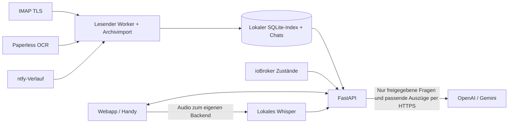

# Butler · Dein persönlicher Wissensraum

Eine lokale Webapp nach dem Prinzip „Fragen an dein eigenes Wissen“: Der Butler durchsucht E-Mails, Paperless-ngx-Dokumente und ntfy-Ereignisse und berücksichtigt bei passenden Fragen den Zustand deines ioBroker. Antworten bleiben kurz; Belege lassen sich separat öffnen. Spracheingabe wird auf deinem Butler-Rechner verarbeitet.

**Für einen dauerhaften Betrieb ist der Linux-LXC-Installer unten vorgesehen.** Die Installation richtet einen eigenen Dienstbenutzer, den automatischen Start und den Befehl `aibutler` für Updates und Wartung ein. Dein bestehender Entwicklungsstand wird dadurch nicht automatisch ins LXC übertragen; dafür gibt es unten eine Migrationsanleitung.

## 1. Voraussetzungen

| Voraussetzung | Empfehlung / Bedeutung |
| --- | --- |
| Betriebssystem | Debian 12/13 oder Ubuntu 24.04+, jeweils mit laufendem systemd |
| Ziel | Linux-LXC, VM oder eigener Linux-Rechner; ein unprivilegierter Proxmox-LXC mit systemd genügt. Kein Docker oder Nesting erforderlich. |
| Ressourcen | Empfohlen: 2 CPU-Kerne, 4 GB RAM und mindestens 10 GB freier Speicher. Archive, Backups und alte Releases benötigen zusätzlich Platz. |
| Architektur | 64 Bit; Verfügbarkeit der Python-/Sprachbibliotheken hängt von der Plattform ab. Die Installation bricht bei fehlenden Paketen ab. |
| Berechtigung | Als `root` in der LXC-Konsole oder per SSH; alternativ `sudo` verwenden. |
| Netzwerk | Internet für GitHub, Debian-/Ubuntu-Pakete, Python-Pakete und optional den ersten Sprachmodell-Download. Zugriff vom LXC auf deine angebundenen Dienste. |
| Handy | Eine eigene HTTPS-Adresse mit gültigem Zertifikat und ein Reverse-Proxy. Auf dem Handy ist `localhost` das Handy selbst, nicht dein LXC. |
| KI-Anbieter | Ein eigener OpenAI- oder Gemini-API-Key, erst später in den Einstellungen eingeben. Eine installierte App funktioniert zunächst auch mit lokaler Suche. |

In einem frischen LXC fehlen manchmal curl und die Zertifikate für den HTTPS-Download. Dann einmal ausführen:

```bash
apt-get update && apt-get install -y curl ca-certificates
```

Der Installer installiert Python bei Bedarf und die übrigen Systempakete selbst. Node.js ist im laufenden Betrieb nicht erforderlich; das gebaute Frontend liegt bereits im Repository.

## 2. Installation mit einem Einzeiler

In der **Linux-LXC-Konsole als root**:

```bash
curl -fsSL https://raw.githubusercontent.com/Schello805/aibutler/main/install.sh | bash
```

Wenn du als normaler Benutzer mit sudo arbeitest, am Ende `| sudo bash` verwenden. Der Einzeiler führt das Installationsskript dieses Repositories mit Administratorrechten aus. Zum vorherigen Lesen stattdessen herunterladen:

```bash
curl -fsSLo install.sh https://raw.githubusercontent.com/Schello805/aibutler/main/install.sh
less install.sh
bash install.sh --help
bash install.sh
```

Die Standardinstallation lädt auch das lokale Sprachmodell Whisper-base herunter. Modellgewichte sind öffentliche Dateien; der Download überträgt keine E-Mails, Dokumente oder Audioaufnahmen.

### Zunächst ohne Domain testen

Ohne weitere Optionen lauscht der Dienst ausschließlich auf `127.0.0.1:8010` **im LXC**. Das öffnet keine ungeschützte Weboberfläche im LAN oder Internet.

Auf deinem PC/Mac einen SSH-Tunnel zum LXC öffnen und das Terminal offen lassen:

```bash
ssh -N -L 8010:127.0.0.1:8010 root@LXC-IP
```

`LXC-IP` durch die tatsächliche Container-IP ersetzen. Danach **auf deinem PC** [http://127.0.0.1:8010](http://127.0.0.1:8010) öffnen. Auf dem PC darf Port 8010 nicht schon von der Entwicklungs-App belegt sein. In diesem Fall beispielsweise einen anderen lokalen Port verwenden:

```bash
ssh -N -L 8012:127.0.0.1:8010 root@LXC-IP
```

Dann `http://127.0.0.1:8012` öffnen. Beim ersten lokalen Zugriff lässt sich ein Administratorkonto mit E-Mail-Adresse und Passwort einrichten. Danach erfolgt die Anmeldung mit diesem Konto. Der interne API-Token wird vom Installer zufällig erzeugt und nicht für die Browseranmeldung eingegeben.

### Direkt mit eigener HTTPS-Adresse installieren

Wenn Domain und Reverse-Proxy bereits vorhanden sind:

```bash
curl -fsSL https://raw.githubusercontent.com/Schello805/aibutler/main/install.sh | bash -s -- --domain ai.example.com --proxy-ip 192.168.1.10
```

**Beide Angaben ersetzen:** `ai.example.com` ist deine Domain, `192.168.1.10` die IP des eigenen Reverse-Proxys, die das Backend tatsächlich als Verbindungsquelle sieht. Niemals `*` als Proxy verwenden. Für HTTPS-Weiterleitungen vertraut der Butler ausschließlich dieser IP.

Mit Domain lauscht der Backend-Port auf `0.0.0.0`, damit dein Proxy ihn erreichen kann. DNS, Zertifikat, Firewall und Reverse-Proxy werden **nicht** automatisch angelegt. Siehe Abschnitt 4.

### Weitere Installationsoptionen

```bash
# Ohne Sprachbibliotheken/Sprachmodell, später nachrüstbar:
curl -fsSL https://raw.githubusercontent.com/Schello805/aibutler/main/install.sh | bash -s -- --no-speech

# Anderen Backend-Port nutzen:
bash install.sh --port 8012

# Einen bestimmten Branch, Tag oder Commit installieren:
bash install.sh --ref main

# Optionen ohne Installation, Netzwerkzugriff oder Dienständerung prüfen:
bash install.sh --check --domain ai.example.com --proxy-ip 192.168.1.10
```

`--ref` muss auf eine Version zeigen, die den Installer und die zugehörigen Managementdateien enthält. Die Version vor Einführung des Installers lässt sich damit nicht als verwaltetes Release installieren. Hilfe: `bash install.sh --help`.

## 3. Was wird eingerichtet?

| Pfad / Bestandteil | Inhalt |
| --- | --- |
| `/opt/aibutler/releases/…` | Versionierter Quellcode mit eigener Python-Umgebung pro Release |
| `/opt/aibutler/current` | Verweis auf die aktive Version |
| `/var/lib/aibutler/butler.sqlite3` | Lokaler Index, Gespräche, Belege, Kontext, Ereignisse und Importfortschritt |
| `/var/lib/aibutler/config/.env` | Zugangsdaten und App-Einstellungen; nur Dienstbenutzer/root |
| `/var/lib/aibutler/models/` | Lokale Sprachmodell-Gewichte |
| `/var/lib/aibutler/cache/` | Herunterladbare Modell-Caches |
| `/etc/aibutler/install.json` | Installationsoptionen und aktive Commit-ID, nur root |
| `/etc/aibutler/service.env` | Vom Installer verwaltete Dienstparameter, nur root |
| `/etc/systemd/system/aibutler.service` | Systemdienst, startet nach erfolgreicher Installation auch nach einem Neustart |
| `/usr/local/bin/aibutler` | Verwaltungsbefehl |
| `/var/backups/aibutler/…` | Private Sicherungen vor Updates und manuelle Backups, nur root |

Die App läuft als Benutzer `aibutler`, nicht als root. Der Code ist für den Dienst schreibgeschützt. Einstellungen und Daten liegen außerhalb des Quellcode-Verzeichnisses; ein Versionswechsel ersetzt sie nicht. `BUTLER_ENV_FILE` zeigt dem Backend auf die dauerhafte Konfigurationsdatei, `DATA_DIR` auf den dauerhaften Datenbestand.

## 4. HTTPS, Reverse-Proxy und Handy einrichten

1. Der LXC sollte eine feste IP bzw. DHCP-Reservierung erhalten.
2. DNS für deine Domain auf den eigenen HTTPS-Reverse-Proxy zeigen lassen. Für rein internen Betrieb kann dafür auch internes DNS verwendet werden; das Handy muss die Adresse passend auflösen.
3. Auf dem Proxy ein gültiges, vom Handy akzeptiertes Zertifikat einrichten. Für eine rein interne Instanz lässt sich beispielsweise DNS-basierte Zertifikatsvalidierung verwenden.
4. Proxy-Ziel: **`http://LXC-IP:8010`**, bzw. der gewählte Backend-Port. Host beibehalten und das HTTPS-Schema als `X-Forwarded-Proto: https` weiterreichen.
5. Den Backend-Port per Firewall auf den Proxy begrenzen. Keine direkte Router-Portweiterleitung auf 8010 einrichten. Ein öffentlicher Proxy ist für Nutzung im Heimnetz nicht erforderlich.

**Nginx Proxy Manager:** Einen Proxy Host mit deiner Domain anlegen, Forward Scheme `http`, Forward Hostname/IP = LXC-IP, Forward Port = 8010. Gültiges SSL-Zertifikat auswählen und „Force SSL“ aktivieren. Bei zusätzlichen Proxys/VPNs muss `--proxy-ip` die tatsächliche direkte Gegenstelle des Backends benennen.

**Caddy:** Eine Vorlage liegt in [deploy/Caddyfile](deploy/Caddyfile). Domain und LXC-IP ersetzen. Den Proxy selbst richtest du auf deinem vorhandenen Proxy-System ein.

Wenn du zunächst ohne Domain installiert hast, später umstellen:

```bash
aibutler update --domain ai.example.com --proxy-ip 192.168.1.10
```

### Anmeldung mit E-Mail-Adresse und Passwort

Kopplungscodes und die automatische Loopback-Anmeldung wurden durch Benutzerkonten ersetzt. Nach einem Update sind alte Kopplungssitzungen ungültig; deine Verbindungen und Archive bleiben erhalten.

Im LXC einmal das erste Konto anlegen:

```bash
aibutler user add deine@email.de
```

Die E-Mail-Adresse durch deine gewünschte Anmeldeadresse ersetzen. Das Terminal fragt das Passwort verdeckt zweimal ab; mindestens zwölf Zeichen verwenden. Das Passwort gehört **nicht** in den Befehl, die Shell-History oder einen Chat. Das erste Konto ist automatisch Administrator. Alternativ kann die Ersteinrichtung über die lokale Oberfläche bzw. den SSH-Tunnel erfolgen; über die öffentliche Domain gibt es keine offene Selbstregistrierung.

Danach die HTTPS-Adresse auf Handy oder PC öffnen und mit E-Mail-Adresse und Passwort anmelden. **„Angemeldet bleiben“** speichert eine widerrufbare Sitzung für 30 Tage; ohne Häkchen wird ein Browser-Sitzungscookie mit maximal zwölf Stunden serverseitiger Gültigkeit verwendet. Normale Updates behalten die Konten und Sitzungen bei. Die E-Mail-Adresse dient als Anmeldename; die App versendet keine Registrierungs- oder Passwort-Reset-E-Mails.

Unter **Einstellungen → Benutzerkonten** können Administratoren weitere Konten anlegen und sperren. Mitglieder können die verbundenen Quellen gemeinsam nutzen und Fragen stellen. Nur Administratoren ändern Verbindungen, Projektkontext und Benutzerkonten. **Gesprächsverläufe sind je Konto getrennt.** Das erste Administratorkonto übernimmt die bisherigen, noch keinem Konto zugeordneten Gespräche. Es gibt keine getrennten Quellenbestände pro Person; wer Zugriff bekommt, kann Inhalte aus den gemeinsamen Quellen abfragen.

Unter **Mein Konto** lassen sich Passwort und Anmeldung verwalten. Passwortänderungen und Kontosperren widerrufen bestehende Sitzungen; nach einer Passwortänderung bleibt nur die neu ausgestellte Sitzung des aktuellen Browsers bestehen. „Abmelden“ widerruft die aktuelle Sitzung serverseitig. Passwörter werden mit Argon2id gehasht und nicht im Klartext gespeichert; die internen Sitzungstokens sind nur als SHA-256-Digest gespeichert. Grundlage: [OWASP-Passwortspeicherung](https://cheatsheetseries.owasp.org/cheatsheets/Password_Storage_Cheat_Sheet.html).

Bei vergessenem Passwort im LXC:

```bash
aibutler user passwd deine@email.de
```

Weitere Konsolenbefehle:

```bash
aibutler user list
aibutler user add weitere@email.de
aibutler user add admin@email.de --admin
aibutler user disable weitere@email.de
aibutler user enable weitere@email.de
```

Der letzte aktive Administrator kann nicht gesperrt werden. Fehlgeschlagene Anmeldungen werden begrenzt; nach zehn Fehlversuchen je Adresse bzw. 30 je Verbindungs-IP innerhalb von 15 Minuten ist vorübergehend eine Pause nötig. Ein Passwort-Reset über die LXC-Konsole löst die adressbezogene Sperre auf. Der interne API-Key bleibt ein separater privilegierter Schlüssel für vertrauenswürdige technische Clients und gehört nicht in den Browser.

**Als Webapp hinzufügen:**

- iPhone/iPad: In Safari öffnen → Teilen → „Zum Home-Bildschirm“.
- Android: Browser-Menü → „App installieren“ bzw. „Zum Startbildschirm hinzufügen“.
- Desktop: Installationssymbol in der App bzw. Browser-Installationsangebot verwenden.

Für Sprachgespräche Mikrofonzugriff erlauben, auf die Mikrofontaste tippen und sprechen. Bei aktivierten Optionen wird die Frage nach einer Sprechpause gesendet und die Antwort mit einer verfügbaren lokalen deutschen Systemstimme vorgelesen. Ohne solche Stimme bleibt die Antwort als Text verfügbar. Mikrofontaste erneut antippen beendet das Sprachgespräch. Installation, Audio und Berechtigungen hängen vom tatsächlichen Handy/Browser ab und müssen dort getestet werden.

Der LXC muss für Chat und Recherche laufen und erreichbar sein. Die Offline-Seite enthält keine privaten Antworten; Chats und Quellen werden nicht im Browser-Offline-Cache abgelegt.

## 5. Dienste in der Oberfläche verbinden

Unter **Einstellungen → Verbindungen** jeden Dienst einzeln speichern und testen. Gespeicherte Passwörter/Keys werden nicht zurück angezeigt; leere Schlüsselfelder behalten den vorhandenen Wert.

| Verbindung | Benötigte Angaben / Hinweise |
| --- | --- |
| OpenAI / Gemini | Anbieter, API-Key und Modell. Die Modellliste lässt sich mit dem Key laden. Chat-KI und automatische Hintergrund-KI sind getrennte Freigaben; beide sind bei einer frischen Installation aus. Für Gemini müssen geeignete Daten-/Vertragsbedingungen bestätigt werden. |
| E-Mail | IMAP-Server, TLS-Port (meist 993), Benutzername, Passwort/App-Passwort und Ordner für den laufenden Abruf. Optional gesamten noch lesbaren Altbestand und alle lesbaren Ordner lokal einlesen. |
| Paperless-ngx | Vollständige Instanz-URL und API-Token mit Leserechten auf die gewünschten Dokumente. Die Anwendung verwendet die von Paperless bereitgestellten OCR-Texte. |
| ioBroker | Adresse des Simple-API- oder REST-API-Adapters, **nicht** die Admin-Oberfläche auf Port 8081. Simple-API liegt häufig auf 8087. Zugangsdaten nach Konfiguration des Adapters; nur lesender Zugriff wird benötigt. |
| ntfy | Topic-URL für eigene Benachrichtigungen; optional Token. Zusätzlich die zu lesenden Ereignis-Topic-URLs, je eine pro Zeile. Der Verbindungstest sendet ausdrücklich eine Testnachricht. |
| Projekte / Pläne | Unter „Mein Kontext“ Bezeichnung, Schlagwörter und Hinweise hinterlegen, damit aktuelle Vorhaben bei der Einordnung berücksichtigt werden. |

Fragen wie **„Welche Lichter sind gerade noch an?“** lesen Schalt- und Dimmzustände direkt aus der ioBroker-Simple-API. Diese klaren Statusfragen benötigen keinen KI-Aufruf und funktionieren auch bei einem Anfragelimit des KI-Anbieters. Die Antwort trägt „LIVE-ABFRAGE“; Zeitstempel und Belege stehen separat bereit. Raum-/Funktionszuordnungen und lesbare Gerätenamen dienen der Auswahl. Technische Statuswerte, Skript-Aktivierungen und Sensormessungen werden nicht als eingeschaltete Lampen gezählt. Nicht erreichbare oder unbestätigte Zustände bleiben unklar. Es werden keine Geräte geschaltet. Für diese direkte Lichtabfrage ist die Simple-API erforderlich; allgemeine REST-API-Snapshots ersetzen die vollständige Lichtzuordnung noch nicht.

**Wissensquellen** zeigt Mengen und Importfortschritt. Ein großer Mailbestand wird schrittweise und fortsetzbar eingelesen. Das ist kein sofort abgeschlossener Gesamtabruf. Rechnungen, alte E-Mails und bereits importierte Ereignisse sind anschließend lokal durchsuchbar. Zusätzliche passende Quellen werden bei Chatfragen lesend nachgeladen.

## 6. Später aktualisieren – ein Befehl

```bash
aibutler update
```

Als normaler Benutzer `sudo aibutler update`. Der Befehl lädt auch die aktuelle Installer-Logik aus diesem Repository. Ohne zusätzliche Optionen bleiben Domain, Proxy-IP, Port, Sprachoption und ausgewählter Git-Ref erhalten.

Ein Update:

1. Lädt den Quellcode in ein neues Release-Verzeichnis.
2. Installiert dessen Python-Umgebung und führt Paketprüfung sowie die automatischen Tests aus. Der bisherige Dienst läuft währenddessen weiter.
3. Hält den Dienst kurz an und sichert den privaten Datenbestand und die Dienstkonfiguration.
4. Schaltet auf das neue Release um und prüft den Start über `/healthz`.
5. Setzt bei einem Fehler nach der Umschaltung Code, Daten und Dienstkonfiguration aus dem vorigen Backup zurück, soweit diese Wiederherstellung erfolgreich möglich ist. Fehler werden ausgegeben; Logs/Backup bleiben verfügbar.

**Erhalten bleiben:** Zugangsdaten, Quellenkonfiguration, Gespräche mit Belegen, Projektkontext, Dokument-/Mailindex und Importfortschritt. Das Backup wird bei angehaltenem Dienst erstellt, damit SQLite konsistent ist. Bei der Umstellung sind laufende Anfragen kurz nicht verfügbar; deshalb Updates außerhalb eines aktiven Sprach-/Chatgesprächs ausführen.

Weitere Beispiele:

```bash
# Lokale Sprache später nachrüsten:
aibutler update --speech

# Sprache deaktivieren; vorhandene Modell-Dateien bleiben für spätere Nutzung erhalten:
aibutler update --no-speech

# Neue Domain oder geänderte Proxy-IP übernehmen:
aibutler update --domain ai.example.com --proxy-ip 192.168.1.20

# Wieder nur Loopback, z. B. für SSH-Tunnel:
aibutler update --local-only

# Bestimmten verfügbaren Release-Tag/Commit nutzen:
aibutler update --ref main
```

Die Anwendung kann ihre SQLite-Struktur beim Start erweitern. Deshalb stellt ein Rollback auch den Datenstand des Sicherungszeitpunkts wieder her, nicht nur alte Programmdateien.

## 7. Wartung, Backups und Rollback

```bash
aibutler status             # systemd-Status
aibutler logs               # Live-Logs; Ctrl+C beendet nur die Loganzeige
aibutler restart            # Dienst neu starten
aibutler user list          # Benutzerkonten anzeigen
aibutler user passwd EMAIL # Passwort zurücksetzen
aibutler backup             # Konsistentes privates Backup, kurze Dienstpause
aibutler backups            # Sicherungen auflisten
aibutler rollback           # Sicherung vor dem letzten erfolgreichen Update
aibutler rollback /var/backups/aibutler/DEIN-BACKUP
```

Backups enthalten **Zugangsdaten und private Inhalte im Klartext**. Außerhalb des LXC geschützt sichern, beispielsweise verschlüsselt auf einem eigenen Backup-System. Ein Snapshot desselben LXC allein schützt nicht vor Verlust des Hosts.

Eine Sicherung umfasst SQLite, `.env`, weitere private Dateien sowie Installations-/Dienstkonfiguration und die Referenz auf das bisherige Release. Öffentliche Sprachmodell-Gewichte und Modell-Caches werden nicht in jedes Backup kopiert; sie bleiben bei Updates erhalten bzw. lassen sich neu laden. Für das Rollback muss das im Backup referenzierte Release noch unter `/opt/aibutler/releases/` vorhanden sein.

Beim Restore wird der jüngere Datenstand **nicht gelöscht**, sondern nach `/var/lib/aibutler-before-restore-…` verschoben. Aus Sicherheitsgründen werden beim Restore gespeicherte Benutzersitzungen verworfen; danach erneut anmelden. Ältere Backups, Releases und solche Datenstände werden nicht automatisch entfernt. Speicherverbrauch prüfen:

```bash
du -sh /opt/aibutler/releases /var/lib/aibutler /var/backups/aibutler
```

Bereinigung bewusst selbst vornehmen und das für ein gewünschtes Rollback benötigte Release behalten. Zugangsdaten nach einem Restore können ältere Werte enthalten. Für einen vollständigen Neuaufbau auf einem anderen Server zusätzlich ein geschütztes Backup der verwalteten Installation/System- oder LXC-Backups vorhalten; der Rollback-Befehl ist auf dem bestehenden LXC mit den referenzierten Releases vorgesehen.

## 8. Vorhandene Entwicklung ins LXC übernehmen

Der Installer lädt **keine** persönlichen Entwicklungsdaten aus GitHub. Sie sind dort bewusst ausgeschlossen. Wenn du vorhandene Verbindungen und Gespräche mitnehmen möchtest:

1. Im LXC zuerst normal installieren. Dort noch keine neuen Quellen konfigurieren.
2. Auf dem bisherigen Rechner den Entwicklungs-Butler anhalten, damit Datenbank und Einstellungen beim Kopieren konsistent sind.
3. Im lokalen Projektverzeichnis ein privates Transferarchiv erstellen und per SSH ins LXC kopieren:

   ```bash
   tar -czf /tmp/aibutler-private.tar.gz .env data
   scp /tmp/aibutler-private.tar.gz root@LXC-IP:/root/
   ```

4. Im LXC importieren. Die Befehle übernehmen den alten privaten Bestand; vorher `aibutler backup` ausführen, falls dort schon eigene Daten existieren:

   ```bash
   systemctl stop aibutler
   mkdir -m 700 /root/aibutler-transfer
   tar -xzf /root/aibutler-private.tar.gz -C /root/aibutler-transfer
   cp -a /root/aibutler-transfer/data/. /var/lib/aibutler/
   install -o aibutler -g aibutler -m 600 /root/aibutler-transfer/.env /var/lib/aibutler/config/.env
   chown -R aibutler:aibutler /var/lib/aibutler
   chmod -R go-rwx /var/lib/aibutler
   systemctl start aibutler
   aibutler status
   ```

5. Domain-/Proxy-Einstellungen kommen weiterhin aus den Installationsoptionen im LXC; alte lokale `DATA_DIR`-/`PUBLIC_ORIGIN`-Werte werden vom systemd-Dienst überschrieben. Mit dem übernommenen Konto anmelden; falls noch kein Konto angelegt war, einmal `aibutler user add DEINE-EMAIL` ausführen.
6. Die privaten Transferdateien auf beiden Rechnern nach erfolgreicher Prüfung geschützt aufbewahren oder bewusst entfernen. Niemals in GitHub hochladen.

Bereits vorhandene manuelle Installationen unter `/opt/aibutler` überschreibt der Installer nicht. Zuerst deren private Daten sichern, die manuelle Code-Installation an einen anderen Ort verschieben und dann den verwalteten Installer verwenden. Quellcode-Änderungen im verwalteten Release sind nicht als dauerhafte Konfiguration vorgesehen; dafür einen eigenen Git-Ref nutzen.

## 9. Häufige Probleme

| Problem | Prüfen / Lösung |
| --- | --- |
| Einzeiler meldet „curl fehlt“ | Bootstrap-Pakete aus Abschnitt 1 installieren. |
| „systemd muss laufen“ | Richtigen LXC/VM mit systemd verwenden, nicht einen Container ohne Init-System. |
| Python zu alt | Debian 12+ oder Ubuntu 24.04+ verwenden; der Installer fügt kein fremdes Python-PPA hinzu. |
| Installation/Paketdownload schlägt fehl | Internet/DNS und Architektur prüfen. Bei Updates läuft der bisherige Dienst während der Vorbereitung weiter. |
| Port belegt | `ss -ltnp` prüfen und beispielsweise `--port 8012` verwenden. Proxy/Tunnel entsprechend anpassen. |
| Domain noch nicht erreichbar | DNS/Zertifikat/Proxy fehlen; zuerst per SSH-Tunnel testen. Installer legt sie nicht automatisch an. |
| HTTPS-Adresse liefert 403 | Domain muss exakt passen; Proxy-IP muss der direkten Gegenstelle entsprechen, Host und HTTPS-Schema müssen weitergegeben werden. |
| HTTP-Aufruf per LXC-IP funktioniert nicht | Im Standardbetrieb ist nur Loopback erlaubt. Für LAN-Zugriff den HTTPS-Proxy einrichten; Backend-IP im Browser ersetzt die konfigurierte Domain nicht. |
| Handy verlangt eine Anmeldung | Mit E-Mail-Adresse und Passwort anmelden. Erstes Konto: `aibutler user add DEINE-EMAIL`. Passwort vergessen: `aibutler user passwd DEINE-EMAIL`. |
| Mikrofon fehlt/blockiert | HTTPS und Browserberechtigung prüfen. Ohne Sprachinstallation mit `aibutler update --speech` nachrüsten. Lokale deutsche Stimme für Vorlesen installieren. |
| KI antwortet lokal statt mit Modell | Chat-KI-Freigabe, Modell, Key und Anbieterlimits prüfen. HTTP 429 ist eine Begrenzung beim Anbieter. |
| Wenige alte Mails sichtbar | Import läuft noch; Fortschritt in „Wissensquellen“ prüfen. Leserechte und Ordnerauswahl kontrollieren. |
| Altes ntfy-Ereignis fehlt | Nur der serverseitig noch verfügbare Verlauf kann eingelesen werden; abgelaufene Meldungen lassen sich nicht nachträglich rekonstruieren. |
| Update/Restore gesperrt | Eine andere Verwaltungsaktion hält den exklusiven Lock; warten, statt parallel zu installieren. |

Details zum Startfehler:

```bash
systemctl --no-pager --full status aibutler
journalctl -u aibutler -n 100 --no-pager
curl -f http://127.0.0.1:8010/healthz
```

Der Healthcheck bestätigt den Backend-Start, nicht die Erreichbarkeit deiner externen Quellen oder deines HTTPS-Proxys. Diese getrennt in der Oberfläche testen.

## 10. Datenschutz, Funktionsumfang und Grenzen

- Dokumenttexte, E-Mails, Kontext, Chats und Index liegen lokal im LXC in SQLite/Dateien. Sie sind **durch die App nicht verschlüsselt**; Dateirechte und bei Bedarf Datenträger-/Backup-Verschlüsselung verwenden.
- Chat-KI und Hintergrund-KI sind getrennt. Bei einer frischen Installation sind beide aus. Mit Chatfreigabe erhält der gewählte Anbieter die Frage, passenden Kontext/Belege und für Rückfragen bis zu sechs letzte Gesprächsnachrichten, je auf 1.600 Zeichen begrenzt. Die Anbieterfreigabe ist keine Anonymisierung.
- OpenAI-/Gemini-Aufrufe verwenden HTTPS mit Zertifikatsprüfung. Der Anbieter entschlüsselt die ausgewählten Inhalte zur Verarbeitung. Eine Garantie „beim Anbieter kann niemand lesen“ gibt es damit nicht. Dafür wäre ein lokales Sprachmodell nötig. OpenAI-Aufrufe setzen `store:false`; das ist keine Zusage vollständiger Zero Data Retention.
- Spracheingabe: Audio wird vom Handy an den eigenen Butler übertragen und dort mit Whisper verarbeitet, nicht an einen externen Sprachdienst gesendet. Audio wird von der App nicht dauerhaft gespeichert. Das erkannte Frage-Transkript geht bei aktiver Chat-KI an den gewählten Anbieter.
- IMAP nutzt TLS und liest mit `BODY.PEEK[]`/read-only. Paperless, ntfy und ioBroker verwenden die eingerichteten URLs. Ein HTTP-ioBroker oder der HTTP-Upstream zwischen Proxy und LXC ist **kein** verschlüsselter Netzwerkabschnitt. Für Verschlüsselung auf jedem Segment dort ebenfalls HTTPS oder einen verschlüsselten Netzwerktunnel verwenden.
- RAG verwendet lokale SQLite-FTS5-Suche mit KI-geplanter Recherche. Keine Cloud-Embeddings. Mail-Anhänge werden nicht extrahiert; Paperless liefert seine OCR-Texte. Löschungen in Quellsystemen werden derzeit nicht automatisch aus dem lokalen Archiv entfernt.
- Alle noch lesbaren Mailordner lassen sich rückwirkend indexieren. ntfy kann nur noch verfügbare Meldungen liefern. Frühere ioBroker-Zustände sind nur vorhanden, wenn bereits aufgezeichnet oder in Meldungen enthalten; direkte ioBroker-History-Adapter sind noch nicht angebunden.
- Archivimport und Chat erzeugen keine Push-Meldungen. Automatische Benachrichtigungen sind konfigurierbar und werden gebündelt. Ein ausdrücklicher ntfy-Test sendet eine Testnachricht.
- Kein autonomer Mailversand, keine Zahlungen, keine Schreibzugriffe der KI auf Smart-Home-Geräte. WhatsApp-/Facebook-Adapter und allgemeine Websuche sind noch nicht implementiert.
- Benutzerkonten mit Administrator-/Mitgliedsrollen: Quellen und Projektkontext werden gemeinsam genutzt; Gesprächsverläufe sind je Konto getrennt. Kein getrenntes Quellenarchiv pro Haushaltsperson. Nur einen Backend-Prozess betreiben, damit Worker nicht doppelt laufen.

## 11. Lokale Entwicklung ohne Linux-Installer

Python 3.11+, optional Node.js 20+ für CSS-Änderungen. Der Linux-Installer wird auf macOS absichtlich nicht ausgeführt.

```bash
python3 -m venv .venv
source .venv/bin/activate
pip install -r requirements.txt
cp .env.example .env
python -c 'import secrets; print(secrets.token_urlsafe(48))'
# Den erzeugten Wert einmal in .env als API_TOKEN eintragen.
uvicorn backend.main:app --host 127.0.0.1 --port 8010 --workers 1 --no-proxy-headers
```

[http://127.0.0.1:8010](http://127.0.0.1:8010) öffnen. Beim ersten lokalen Aufruf ein Konto einrichten, danach mit E-Mail-Adresse und Passwort anmelden. Der Browser benötigt keine Token-Eingabe. `.env`, `data/` und lokale Backups sind nicht Teil des Git-Repositories.

Lokale Sprache optional nachrüsten:

```bash
.venv/bin/python -m pip install -r requirements-speech.txt
.venv/bin/python scripts/setup_speech.py
```

Frontend bauen und Tests ausführen:

```bash
(cd frontend && npm ci && npm run build)
.venv/bin/python -m pytest -q
bash -n install.sh && bash -n deploy/control.sh
bash install.sh --check --domain ai.example.com --proxy-ip 192.168.1.10
```

### Projektstruktur

```text
install.sh                Linux-Installer und Release-Update
backend/                  FastAPI, Worker, IMAP/Paperless/ntfy/ioBroker, lokaler Store
frontend/                 HTML/Tailwind/JS-Webapp, PWA, Sprachbedienung
deploy/aibutler.service    systemd-Dienst für verwaltete Releases
deploy/control.sh          Verwaltungsbefehl aibutler
deploy/maintenance.py      Konsistente Sicherungen, Restore, Benutzerverwaltung
deploy/Caddyfile           Beispiel für eigenen HTTPS-Proxy
scripts/setup_speech.py    Einmaliger Download lokaler Sprachmodell-Gewichte
tests/                    Automatische API-/Recherche-/Installationsprüfungen
.env.example              Vorlage ohne Zugangsdaten
```

### Architektur



API-Zugriff verwendet eine gültige Sitzung oder `Authorization: Bearer <API_TOKEN>`. `/healthz`, statische Dateien und speziell abgesicherte Anmelde-/Ersteinrichtungsrouten sind Ausnahmen. Wichtige APIs: `/api/chat`, `/api/conversations`, `/api/connections`, `/api/context`, `/api/sync`, `/api/status`, `/api/events` und `/api/speech/transcribe`. Schreibende Cookie-Anfragen müssen von derselben Origin kommen.

Python-Umgebungen werden pro Release direkt an ihrem endgültigen Pfad erstellt: Laut [Python-venv-Dokumentation](https://docs.python.org/3/library/venv.html) sind sie wegen absoluter Interpreterpfade nicht beliebig verschiebbar. Die Dienstparameter folgen der [systemd-Dokumentation](https://www.freedesktop.org/software/systemd/man/latest/systemd.service.html).

Die Python-Abhängigkeiten sind kompatible Versionsbereiche und kein vollständig eingefrorenes Lockfile. Jedes Update prüft die neu aufgelöste Umgebung; ein fremder Paket-/Providerfehler kann trotzdem auftreten. Shell-/API-/Backuptests ersetzen keinen vollständigen Erstinstallations- und Handytest auf deinem tatsächlichen LXC.
