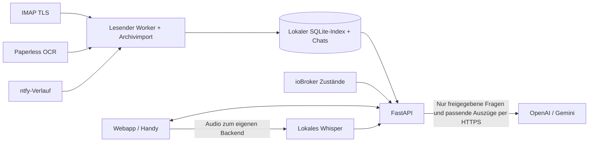

# Butler · Dein persönlicher Wissensraum

Eine lokale Webapp nach dem Prinzip „Fragen an dein eigenes Wissen“: Der Butler durchsucht E-Mails, Paperless-ngx-Dokumente und ntfy-Ereignisse und berücksichtigt bei passenden Fragen den Zustand deines ioBroker. Antworten bleiben kurz; Belege lassen sich separat öffnen. Spracheingabe wird auf deinem Butler-Rechner verarbeitet.

**Für einen dauerhaften Betrieb ist der Linux-LXC-Installer unten vorgesehen.** Die Installation richtet einen eigenen Dienstbenutzer, den automatischen Start und den Befehl `aibutler` für Updates und Wartung ein. Dein bestehender Entwicklungsstand wird dadurch nicht automatisch ins LXC übertragen; dafür gibt es unten eine Migrationsanleitung.

Vorgemerkte Erweiterungen und geprüfte API-Kandidaten stehen in [ROADMAP.md](ROADMAP.md).

## 1. Voraussetzungen

| Voraussetzung | Empfehlung / Bedeutung |
| --- | --- |
| Betriebssystem | Debian 12/13 oder Ubuntu 24.04+, jeweils mit laufendem systemd |
| Ziel | Linux-LXC, VM oder eigener Linux-Rechner; ein unprivilegierter Proxmox-LXC mit systemd genügt. Kein Docker oder Nesting erforderlich. |
| Ressourcen | Empfohlen: 2 CPU-Kerne, 4 GB RAM und mindestens 10 GB freier Speicher. Archive, Backups und alte Releases benötigen zusätzlich Platz. |
| Architektur | 64 Bit; Verfügbarkeit der Python-/Sprachbibliotheken hängt von der Plattform ab. Die Installation bricht bei fehlenden Paketen ab. |
| Berechtigung | Als `root` in der LXC-Konsole oder per SSH; alternativ `sudo` verwenden. |
| Netzwerk | Internet für GitHub, Debian-/Ubuntu-Pakete, Python-Pakete und optional den ersten Sprachmodell-Download. Zugriff vom LXC auf deine angebundenen Dienste. |
| Handy | Eine eigene HTTPS-Adresse mit gültigem Zertifikat und ein Reverse-Proxy. Auf dem Handy ist `localhost` das Handy selbst, nicht dein LXC. |
| KI-Anbieter | Ein eigener OpenAI- oder Gemini-API-Key, erst später in den Einstellungen eingeben. Eine installierte App funktioniert zunächst auch mit lokaler Suche. |

In einem frischen LXC fehlen manchmal curl und die Zertifikate für den HTTPS-Download. Dann einmal ausführen:

```bash
apt-get update && apt-get install -y curl ca-certificates
```

Der Installer installiert Python bei Bedarf und die übrigen Systempakete selbst. Node.js ist im laufenden Betrieb nicht erforderlich; das gebaute Frontend liegt bereits im Repository.

## 2. Installation mit einem Einzeiler

In der **Linux-LXC-Konsole als root**:

```bash
curl -fsSL https://raw.githubusercontent.com/Schello805/aibutler/main/install.sh | bash
```

Wenn du als normaler Benutzer mit sudo arbeitest, am Ende `| sudo bash` verwenden. Der Einzeiler führt das Installationsskript dieses Repositories mit Administratorrechten aus. Zum vorherigen Lesen stattdessen herunterladen:

```bash
curl -fsSLo install.sh https://raw.githubusercontent.com/Schello805/aibutler/main/install.sh
less install.sh
bash install.sh --help
bash install.sh
```

Die Standardinstallation lädt auch das lokale Sprachmodell Whisper-base herunter. Modellgewichte sind öffentliche Dateien; der Download überträgt keine E-Mails, Dokumente oder Audioaufnahmen.

### Zunächst ohne Domain testen

Ohne weitere Optionen lauscht der Dienst ausschließlich auf `127.0.0.1:8010` **im LXC**. Das öffnet keine ungeschützte Weboberfläche im LAN oder Internet.

Auf deinem PC/Mac einen SSH-Tunnel zum LXC öffnen und das Terminal offen lassen:

```bash
ssh -N -L 8010:127.0.0.1:8010 root@LXC-IP
```

`LXC-IP` durch die tatsächliche Container-IP ersetzen. Danach **auf deinem PC** [http://127.0.0.1:8010](http://127.0.0.1:8010) öffnen. Auf dem PC darf Port 8010 nicht schon von der Entwicklungs-App belegt sein. In diesem Fall beispielsweise einen anderen lokalen Port verwenden:

```bash
ssh -N -L 8012:127.0.0.1:8010 root@LXC-IP
```

Dann `http://127.0.0.1:8012` öffnen. Beim ersten lokalen Zugriff lässt sich ein Administratorkonto mit E-Mail-Adresse und Passwort einrichten. Danach erfolgt die Anmeldung mit diesem Konto. Der interne API-Token wird vom Installer zufällig erzeugt und nicht für die Browseranmeldung eingegeben.

### Direkt mit eigener HTTPS-Adresse installieren

Wenn Domain und Reverse-Proxy bereits vorhanden sind:

```bash
curl -fsSL https://raw.githubusercontent.com/Schello805/aibutler/main/install.sh | bash -s -- --domain ai.example.com --proxy-ip 192.168.1.10
```

**Beide Angaben ersetzen:** `ai.example.com` ist deine Domain, `192.168.1.10` die IP des eigenen Reverse-Proxys, die das Backend tatsächlich als Verbindungsquelle sieht. Niemals `*` als Proxy verwenden. Für HTTPS-Weiterleitungen vertraut der Butler ausschließlich dieser IP.

Mit Domain lauscht der Backend-Port auf `0.0.0.0`, damit dein Proxy ihn erreichen kann. DNS, Zertifikat, Firewall und Reverse-Proxy werden **nicht** automatisch angelegt. Siehe Abschnitt 4.

### Weitere Installationsoptionen

```bash
# Ohne Sprachbibliotheken/Sprachmodell, später nachrüstbar:
curl -fsSL https://raw.githubusercontent.com/Schello805/aibutler/main/install.sh | bash -s -- --no-speech

# Anderen Backend-Port nutzen:
bash install.sh --port 8012

# Einen bestimmten Branch, Tag oder Commit installieren:
bash install.sh --ref main

# Optionen ohne Installation, Netzwerkzugriff oder Dienständerung prüfen:
bash install.sh --check --domain ai.example.com --proxy-ip 192.168.1.10
```

`--ref` muss auf eine Version zeigen, die den Installer und die zugehörigen Managementdateien enthält. Die Version vor Einführung des Installers lässt sich damit nicht als verwaltetes Release installieren. Hilfe: `bash install.sh --help`.

## 3. Was wird eingerichtet?

| Pfad / Bestandteil | Inhalt |
| --- | --- |
| `/opt/aibutler/releases/…` | Versionierter Quellcode mit eigener Python-Umgebung pro Release |
| `/opt/aibutler/current` | Verweis auf die aktive Version |
| `/var/lib/aibutler/butler.sqlite3` | Lokaler Index, Gespräche, Belege, Kontext, Ereignisse und Importfortschritt |
| `/var/lib/aibutler/config/.env` | Zugangsdaten und App-Einstellungen; nur Dienstbenutzer/root |
| `/var/lib/aibutler/models/` | Lokale Sprachmodell-Gewichte |
| `/var/lib/aibutler/cache/` | Herunterladbare Modell-Caches |
| `/etc/aibutler/install.json` | Installationsoptionen und aktive Commit-ID, nur root |
| `/etc/aibutler/service.env` | Vom Installer verwaltete Dienstparameter, nur root |
| `/etc/systemd/system/aibutler.service` | Systemdienst, startet nach erfolgreicher Installation auch nach einem Neustart |
| `/usr/local/bin/aibutler` | Verwaltungsbefehl |
| `/var/backups/aibutler/…` | Private Sicherungen vor Updates und manuelle Backups, nur root |

Die App läuft als Benutzer `aibutler`, nicht als root. Der Code ist für den Dienst schreibgeschützt. Einstellungen und Daten liegen außerhalb des Quellcode-Verzeichnisses; ein Versionswechsel ersetzt sie nicht. `BUTLER_ENV_FILE` zeigt dem Backend auf die dauerhafte Konfigurationsdatei, `DATA_DIR` auf den dauerhaften Datenbestand.

## 4. HTTPS, Reverse-Proxy und Handy einrichten

1. Der LXC sollte eine feste IP bzw. DHCP-Reservierung erhalten.
2. DNS für deine Domain auf den eigenen HTTPS-Reverse-Proxy zeigen lassen. Für rein internen Betrieb kann dafür auch internes DNS verwendet werden; das Handy muss die Adresse passend auflösen.
3. Auf dem Proxy ein gültiges, vom Handy akzeptiertes Zertifikat einrichten. Für eine rein interne Instanz lässt sich beispielsweise DNS-basierte Zertifikatsvalidierung verwenden.
4. Proxy-Ziel: **`http://LXC-IP:8010`**, bzw. der gewählte Backend-Port. Host beibehalten und das HTTPS-Schema als `X-Forwarded-Proto: https` weiterreichen.
5. Den Backend-Port per Firewall auf den Proxy begrenzen. Keine direkte Router-Portweiterleitung auf 8010 einrichten. Ein öffentlicher Proxy ist für Nutzung im Heimnetz nicht erforderlich.

**Nginx Proxy Manager:** Einen Proxy Host mit deiner Domain anlegen, Forward Scheme `http`, Forward Hostname/IP = LXC-IP, Forward Port = 8010. Gültiges SSL-Zertifikat auswählen und „Force SSL“ aktivieren. Bei zusätzlichen Proxys/VPNs muss `--proxy-ip` die tatsächliche direkte Gegenstelle des Backends benennen.

**Caddy:** Eine Vorlage liegt in [deploy/Caddyfile](deploy/Caddyfile). Domain und LXC-IP ersetzen. Den Proxy selbst richtest du auf deinem vorhandenen Proxy-System ein.

Wenn du zunächst ohne Domain installiert hast, später umstellen:

```bash
aibutler update --domain ai.example.com --proxy-ip 192.168.1.10
```

### Anmeldung mit E-Mail-Adresse und Passwort

Kopplungscodes und die automatische Loopback-Anmeldung wurden durch Benutzerkonten ersetzt. Nach einem Update sind alte Kopplungssitzungen ungültig; deine Verbindungen und Archive bleiben erhalten.

Im LXC einmal das erste Konto anlegen:

```bash
aibutler user add deine@email.de
```

Die E-Mail-Adresse durch deine gewünschte Anmeldeadresse ersetzen. Das Terminal fragt das Passwort verdeckt zweimal ab; mindestens acht Zeichen verwenden. Das Passwort gehört **nicht** in den Befehl, die Shell-History oder einen Chat. Das erste Konto ist automatisch Administrator. Alternativ kann die Ersteinrichtung über die lokale Oberfläche bzw. den SSH-Tunnel erfolgen; über die öffentliche Domain gibt es keine offene Selbstregistrierung.

Danach die HTTPS-Adresse auf Handy oder PC öffnen und mit E-Mail-Adresse und Passwort anmelden. **„Angemeldet bleiben“** speichert eine widerrufbare Sitzung für 30 Tage; ohne Häkchen wird ein Browser-Sitzungscookie mit maximal zwölf Stunden serverseitiger Gültigkeit verwendet. Normale Updates behalten die Konten und Sitzungen bei. Das eigene Passwort lässt sich jederzeit unter **Einstellungen → Mein Konto → Passwort ändern** ändern, für Administratoren und Mitglieder. Dafür das aktuelle und das neue Passwort eingeben. Ohne bekanntes aktuelles Passwort ist ein Zurücksetzen im LXC über `aibutler user passwd EMAIL` möglich.

Die E-Mail-Adresse dient als Anmeldename; die App versendet keine Registrierungs- oder Passwort-Reset-E-Mails.

Unter **Einstellungen → Benutzerkonten** können Administratoren weitere Konten anlegen und sperren. Mitglieder können die verbundenen Quellen gemeinsam nutzen und Fragen stellen. Nur Administratoren ändern Verbindungen, Projektkontext und Benutzerkonten. **Gesprächsverläufe sind je Konto getrennt.** Das erste Administratorkonto übernimmt die bisherigen, noch keinem Konto zugeordneten Gespräche. Es gibt keine getrennten Quellenbestände pro Person; wer Zugriff bekommt, kann Inhalte aus den gemeinsamen Quellen abfragen.

Unter **Mein Konto** lassen sich Passwort und Anmeldung verwalten. Passwortänderungen und Kontosperren widerrufen bestehende Sitzungen; nach einer Passwortänderung bleibt nur die neu ausgestellte Sitzung des aktuellen Browsers bestehen. „Abmelden“ widerruft die aktuelle Sitzung serverseitig. Passwörter werden mit Argon2id gehasht und nicht im Klartext gespeichert; die internen Sitzungstokens sind nur als SHA-256-Digest gespeichert. Grundlage: [OWASP-Passwortspeicherung](https://cheatsheetseries.owasp.org/cheatsheets/Password_Storage_Cheat_Sheet.html).

Bei vergessenem Passwort im LXC:

```bash
aibutler user passwd deine@email.de
```

Weitere Konsolenbefehle:

```bash
aibutler user list
aibutler user add weitere@email.de
aibutler user add admin@email.de --admin
aibutler user disable weitere@email.de
aibutler user enable weitere@email.de
```

Der letzte aktive Administrator kann nicht gesperrt werden. Fehlgeschlagene Anmeldungen werden begrenzt; nach zehn Fehlversuchen je Adresse bzw. 30 je Verbindungs-IP innerhalb von 15 Minuten ist vorübergehend eine Pause nötig. Ein Passwort-Reset über die LXC-Konsole löst die adressbezogene Sperre auf. Der interne API-Key bleibt ein separater privilegierter Schlüssel für vertrauenswürdige technische Clients und gehört nicht in den Browser.

**Als Webapp hinzufügen:**

- iPhone/iPad: In Safari öffnen → Teilen → „Zum Home-Bildschirm“.
- Android: Browser-Menü → „App installieren“ bzw. „Zum Startbildschirm hinzufügen“.
- Desktop: Installationssymbol in der App bzw. Browser-Installationsangebot verwenden.

Für Sprachgespräche Mikrofonzugriff erlauben, auf die Mikrofontaste tippen und sprechen. Bei aktivierten Optionen wird die Frage nach einer Sprechpause gesendet und die Antwort mit einer verfügbaren lokalen deutschen Systemstimme vorgelesen. Ohne solche Stimme bleibt die Antwort als Text verfügbar. Während der Aufnahme sendet erneutes Antippen die Frage sofort; alternativ genügt eine Sprechpause. „Gespräch beenden“ stoppt Aufnahme, laufende Erkennung oder Vorlesen. Die große Mikrofontaste steht im Mittelpunkt; Texteingabe und Sprach-/Standortoptionen sind separat aufklappbar. Beim Wechsel in den Hintergrund wird das Sprachgespräch beendet. Installation, Audio und Berechtigungen hängen vom tatsächlichen Handy/Browser ab und müssen dort getestet werden.

Der LXC muss für Chat und Recherche laufen und erreichbar sein. Die Offline-Seite enthält keine privaten Antworten; Chats und Quellen werden nicht im Browser-Offline-Cache abgelegt.

## 5. Dienste in der Oberfläche verbinden

Unter **Einstellungen → Verbindungen** jeden Dienst einzeln speichern und testen. Gespeicherte Passwörter/Keys werden nicht zurück angezeigt; leere Schlüsselfelder behalten den vorhandenen Wert.

| Verbindung | Benötigte Angaben / Hinweise |
| --- | --- |
| OpenAI / Gemini | Anbieter, API-Key und Modell. Die Modellliste lässt sich mit dem Key laden. Chat-KI und automatische Hintergrund-KI sind getrennte Freigaben; beide sind bei einer frischen Installation aus. Für Gemini müssen geeignete Daten-/Vertragsbedingungen bestätigt werden. |
| E-Mail | IMAP-Server, TLS-Port (meist 993), Benutzername, Passwort/App-Passwort und Ordner für den laufenden Abruf. Optional gesamten noch lesbaren Altbestand und alle lesbaren Ordner lokal einlesen. |
| Paperless-ngx | Vollständige Instanz-URL und API-Token mit Leserechten auf die gewünschten Dokumente. Die Anwendung verwendet die von Paperless bereitgestellten OCR-Texte. |
| ioBroker | Adresse des Simple-API- oder REST-API-Adapters, **nicht** die Admin-Oberfläche auf Port 8081. Simple-API liegt häufig auf 8087. Zugangsdaten nach Konfiguration des Adapters; nur lesender Zugriff wird benötigt. |
| ntfy | Topic-URL für eigene Benachrichtigungen; optional Token. Zusätzlich die zu lesenden Ereignis-Topic-URLs, je eine pro Zeile. Der Verbindungstest sendet ausdrücklich eine Testnachricht. |
| Projekte / Pläne | Unter „Mein Kontext“ Bezeichnung, Schlagwörter und Hinweise hinterlegen, damit aktuelle Vorhaben bei der Einordnung berücksichtigt werden. |

Fragen wie **„Welche Lichter sind gerade noch an?“** lesen Schalt- und Dimmzustände direkt aus der ioBroker-Simple-API. Diese klaren Statusfragen benötigen keinen KI-Aufruf und funktionieren auch bei einem Anfragelimit des KI-Anbieters. Die Antwort trägt „LIVE-ABFRAGE“; Zeitstempel und Belege stehen separat bereit. Raum-/Funktionszuordnungen und lesbare Gerätenamen dienen der Auswahl. Technische Statuswerte, Skript-Aktivierungen und Sensormessungen werden nicht als eingeschaltete Lampen gezählt. Nicht erreichbare oder unbestätigte Zustände bleiben unklar. Es werden keine Geräte geschaltet. Für diese direkte Lichtabfrage ist die Simple-API erforderlich; allgemeine REST-API-Snapshots ersetzen die vollständige Lichtzuordnung noch nicht.

### Unabhängige Abrufe und lokale Bedeutungssuche

Jede Quelle hat einen eigenen Hintergrundauftrag: IMAP, Paperless, ntfy, ioBroker sowie iCloud-Kalender und -Kontakte. Standard ist `POLL_SECONDS=300` (fünf Minuten); optionale `IMAP_POLL_SECONDS`, `PAPERLESS_POLL_SECONDS`, `NTFY_POLL_SECONDS`, `IOBROKER_POLL_SECONDS`, `ICLOUD_CALENDAR_POLL_SECONDS` und `ICLOUD_CONTACTS_POLL_SECONDS` überschreiben das pro Quelle. Langsame Quellen halten die anderen nicht auf; derselbe Auftrag läuft nie mehrfach gleichzeitig. Historische E-Mails werden weiterhin stapelweise eingelesen, solange der Archivimport aktiv ist. Kalender/Kontakte und aktuelle Zustände werden bei passenden Fragen zusätzlich bedarfsgerecht nachgeladen.

Neue Texte stehen sofort in der lokalen SQLite-Volltextsuche zur Verfügung. Eine freigegebene Hintergrund-KI-Auswertung läuft anschließend über eine dauerhafte Warteschlange; sie verbessert vorhandene Fundstücke, ohne dafür eine weitere Benachrichtigung anzulegen. Historischer Archivimport sendet weiterhin keine Benachrichtigungen und keine automatische KI-Auswertung.

Zusätzlich erstellt **FastEmbed** mit dem mehrsprachigen Modell `paraphrase-multilingual-MiniLM-L12-v2` lokale Vektoren; **Qdrant im eingebetteten Modus** speichert sie unter `DATA_DIR/semantic-vectors`. Es läuft kein zusätzlicher Server. Volltext- und Bedeutungstreffer werden gemeinsam gewichtet, damit sinngleiche Formulierungen gefunden werden können. Treffer sind Kandidaten für die Antwort, kein Beweis für einen Zusammenhang. Graphiti und ein zeitabhängiges Wissensgedächtnis sind noch nicht integriert.

Der Installer lädt einmalig ungefähr 220 MB öffentliche Suchmodell-Gewichte. Bei Updates werden vorhandene Gewichte wiederverwendet. `--no-semantic` deaktiviert den Modell-Download und die Bedeutungssuche; `--semantic` aktiviert sie wieder. Bei manueller Entwicklung zunächst `.venv/bin/python scripts/setup_semantic.py` ausführen. Im Betrieb erfolgt die Vektorberechnung ausschließlich lokal, ohne Modell-Downloads. Ohne fertiges Modell oder während des Aufbaus bleibt die Volltextsuche nutzbar. Ein schmaler Fortschrittsbalken zeigt die bereits verarbeiteten Textabschnitte; der Aufbau setzt nach einem Neustart fort.

Vektoren sind sensible abgeleitete Daten und durch die App nicht verschlüsselt. Backups lassen diesen rekonstruierbaren Vektorindex sowie öffentliche Modellgewichte aus; nach Wiederherstellung wird der Index aus den gesicherten lokalen Texten neu aufgebaut. Für den Gesamtbestand wird zusätzlicher Speicher und CPU benötigt. Das Modell arbeitet mit einem CPU-Thread und kleinen Stapeln. Die externe Chat-KI erhält weiterhin nur die freigegebenen passenden Auszüge über HTTPS; der Anbieter kann diese im Klartext verarbeiten.

Während der erstmaligen Indexierung erscheint auch im Chat eine dezente Statusanzeige mit schmalen Balken für E-Mails, Paperless-Dokumente und ntfy-Verlauf. Bekannte Mengen werden als „erfasst / gesamt“ angezeigt; während der Bestandsaufnahme bleibt der Balken unbestimmt. Die Anzeige aktualisiert sich alle fünf Sekunden, zeigt Unterbrechungen oder pausierte Importe und verschwindet nach Abschluss automatisch. ioBroker liefert aktuelle Zustände bei passenden Fragen und hat keinen vollständigen rückwirkenden Datenbestand.

Typische Recherchefälle und ihre Grenzen sind in [ANSWER_QUALITY.md](ANSWER_QUALITY.md) dokumentiert. Fällt die KI-Suchplanung aus, bleiben passende E-Mail-, Paperless- und ntfy-Abfragen über einen lokalen Rechercheplan verfügbar. Das schaltet keine externe KI-Freigabe ein.

**Wissensquellen** zeigt Mengen und Importfortschritt. Ein großer Mailbestand wird schrittweise und fortsetzbar eingelesen. Das ist kein sofort abgeschlossener Gesamtabruf. Rechnungen, alte E-Mails und bereits importierte Ereignisse sind anschließend lokal durchsuchbar. Zusätzliche passende Quellen werden bei Chatfragen lesend nachgeladen.

### iCloud-Kalender und Kontakte – dynamische persönliche Quellen

1. Im [Apple Account](https://account.apple.com/) unter **Anmeldung und Sicherheit → App-spezifische Passwörter** ein eigenes Passwort für den Butler erstellen. Dafür benötigt der Apple Account Zwei-Faktor-Authentifizierung. Das normale Apple-Passwort gehört nicht in den Butler. Siehe [Apple-Anleitung](https://support.apple.com/de-de/102654). Apple kann app-spezifische Passwörter bei Änderung des Hauptpassworts widerrufen.
2. Unter **Einstellungen → Verbindungen** **iCloud · Kalender** bzw. **iCloud · Kontakte** einzeln aktivieren, Apple-Account-Adresse und app-spezifisches Passwort eingeben, speichern und testen. Die Passwörter werden nur lokal gespeichert und nicht zurück angezeigt. Für beide Verbindungen dürfen getrennte app-spezifische Passwörter verwendet werden.
3. Beim Kalender optional exakte Kalendernamen mit Komma getrennt angeben, z. B. `Privat,Familie`. Leer bedeutet alle lesbaren Kalender dieses Accounts. Freigegebene Familienkalender müssen in diesem Apple Account tatsächlich angenommen und lesbar sein. Der Test nennt die gefundenen Sammlungen; ein nicht verfügbarer ausgewählter Name führt zu einem Fehler.
4. Optional unter **Einstellungen → Mein Konto → Meine Kontaktkarte und dynamische Angaben** die eigene Kontaktkarte suchen und ausdrücklich zuordnen. Diese Zuordnung gilt nur für das angemeldete Butler-Konto. Firma, Position und Beziehungsangaben werden nicht als fixe Werte übernommen, sondern bei passenden Fragen neu aus der Karte gelesen. Eine ausdrücklich in der eigenen Kontaktkarte eingetragene Ehepartner-Beziehung kann passende Kontakt-Mailadressen zuordnen; ähnliche Namen allein reichen dafür nicht.

**Nur lesend:** Der Adapter erlaubt ausschließlich `PROPFIND` und `REPORT`, keine Änderungen oder Löschungen bei Apple. Apple-Zugangsdaten werden nur an fest geprüfte HTTPS-iCloud-Hosts für CalDAV/CardDAV gesendet; Weiterleitungen auf fremde Hosts sind blockiert. Der Butler kann die Rechte des Apple-Passworts selbst nicht auf Leserechte einschränken: Das Passwort weiterhin wie einen vollständigen Zugangsschlüssel behandeln. Kalender und Kontakte sind wie die übrigen Quellen allen berechtigten Butler-Nutzern gemeinsam zugänglich. Nur vertrauenswürdige Konten freischalten und sensible Kalender durch Auswahl ausschließen.

Kalenderabfragen haben einen konkreten Zeitraum; normale Fragen verwenden den erkannten Tag, mehrdeutige Zeiträume eine begrenzte Übersicht. Wiederkehrende Termine, Ausnahmen, Verschiebungen, Absagen, Zeitzonen und ganztägige Einträge werden ausgewertet. Sehr dichte Serien und zu große/unvollständige Antworten werden abgelehnt, statt daraus vermeintlich freie Zeit abzuleiten. Ohne passende Zeitangabe werden keine festen Arbeitszeiten geraten. Ein freier Kalender beweist nicht, dass du frei hast.

Im Hintergrund werden bei aktivem Worker Kontakte und eine Kalenderübersicht regelmäßig aktualisiert. Bei Fragen werden passende Daten nachgeladen: Kalender dürfen bis zu 60 Sekunden, Kontakte bis zu fünf Minuten aus dem frischen lokalen Cache stammen. Fragen zum eigenen Arbeitgeber und ausdrückliche Live-/Aktualitätsfragen erzwingen einen neuen Abruf, soweit kein kurzfristiger Fehler-Cooldown besteht. Ausfälle erhalten den letzten Stand, kennzeichnen ihn aber als veraltet. Ein vollständiger erfolgreicher Abruf ersetzt den Snapshot, sodass gelöschte Kontakte oder Termine nicht weiterhin als aktuell verwendet werden. Frühere Belege im Chatverlauf bleiben historische Belege.

**Lernen und Aktualität:** Die App verknüpft Quellen und kann frühere Informationen wiederfinden. Sie trainiert dabei kein eigenes Sprachmodell und führt noch kein allgemeines, automatisch bestätigtes Langzeitprofil. Eine aktuelle Kontaktkarte oder ein Kalendertermin sind beobachtete Quellen, keine Garantie für die reale Beschäftigung oder eine Arbeitszeitregel. Explizite aktuelle Aussagen des Nutzers sollen Vorrang haben; bei Widersprüchen soll die KI nachfragen. Ein Arbeitgeberwechsel kann nur erkannt werden, wenn eine zugängliche Quelle ihn zeigt. Optional bestätigte Regeln bleiben sinnvoll für Angaben, die nirgends verlässlich stehen.

Die Quelldaten und Snapshots liegen lokal in der geschützten SQLite-Datenbank. Kontakt-Notizfelder werden nicht übernommen. Bei freigegebener Chat-KI können nur die für die Frage ausgewählten Termine und Kontakte als zusätzliche Belege an den konfigurierten KI-Anbieter gehen; Apple-Passwörter gehören nie zum KI-Kontext. Die tatsächliche iCloud-Verbindung muss nach Eingabe eigener Zugangsdaten getestet werden; die automatisierten Tests verwenden synthetische DAV-Antworten.

### Wetter, Feiertage und frühere Vorhaben kombinieren

Unter **Einstellungen → Verbindungen** lassen sich **Wetter · Open-Meteo** und **Feiertage · Nager.Date** einzeln aktivieren, speichern und testen. Dafür sind keine API-Keys nötig. Open-Meteo ist hier für private, nichtkommerzielle Nutzung vorgesehen. Öffentliche Daten werden zeitlich begrenzt lokal zwischengespeichert und getrennt vom privaten Dokumentindex geführt.

Der Ort wird **pro fragendem Gerät** gewählt: Im Chat **„Standort an Wetter-/Ortsdienste freigeben“** aktivieren und die Browserfreigabe erteilen. Das funktioniert unter HTTPS oder localhost; am Handy muss die HTTPS-Adresse des Butlers verwendet werden. Abfragen erfolgen nur bei passenden Fragen, ohne dauerhafte Ortung. Der Browser rundet Koordinaten auf zwei Nachkommastellen, bevor sie übertragen werden. Alternativ über **Ort wählen** einen Ort suchen und für die aktuelle Sitzung auswählen; dieser wird beim Abmelden verworfen. Eine Standortfreigabe ist keine Garantie für eine genaue GPS-Position, insbesondere am Desktop oder nahe Landesgrenzen.

**Datenempfänger:** Für Wetter erhält Open-Meteo gerundete Koordinaten; für die manuelle Ortssuche nur den eingegebenen Ortsnamen. Für automatische Land-/Bundeslanderkennung ruft der Browser zusätzlich BigDataCloud mit dem aktuellen gerundeten Standort auf. BigDataCloud verwendet Standort/IP-Paare zur Verbesserung seiner Geodaten; siehe [Datennutzung](https://www.bigdatacloud.com/docs/article/why-is-reverse-geocoding-api-free). Wer das vermeiden möchte, wählt den Ort manuell. Nager.Date erhält nur Land und Jahr. E-Mails, Dokumente und Chattexte werden an diese Datendienste nicht gesendet. Die separate Freigabe für externe Chat-KI bleibt davon unberührt. Ortsbezeichnungen können zusammen mit den Wetterbelegen im privaten Chatverlauf erhalten bleiben; es gibt keinen fortlaufenden Standortverlauf im Hintergrund.

Bei **„Kann ich morgen draußen arbeiten?“** sucht der Butler zusätzlich lokal nach passenden Bitten und Vorhaben in indexierten E-Mails und Dokumenten. Eine Mail „Bitte baue den Hühnerstall“ kann so mit der Tagesprognose verknüpft werden. Der Status bleibt ohne Fortschrittsmeldung unbekannt; eine alte Bitte wird nicht automatisch zur offenen Aufgabe. Bei mehreren passenden Projekten soll die KI nachfragen. Der Gerätestandort ist nicht automatisch der Standort des Gartens oder Projekts. Bei noch laufendem Archivimport oder unvollständiger Suche können Vorhaben fehlen. Dies ist eine gezielte lokale Suche mit KI-Verknüpfung, kein unbegrenzt zuverlässiges Gedächtnis.

Wetterprognosen umfassen bis zu sieben Tage, mit Temperatur, Niederschlag und Wind für 7–19 Uhr. Veraltete Cache-Daten werden gekennzeichnet. Feiertage werden nach Land und, sofern bekannt, Bundesland gefiltert; kommunale Ausnahmen und örtliche Lärmregeln sind nicht vollständig abgedeckt. Ein fehlender Feiertagseintrag ist keine rechtliche Erlaubnis für laute Arbeiten. Die Quellen sind im Belegdialog verlinkt: [Open-Meteo](https://open-meteo.com/) (CC BY 4.0), [Nager.Date](https://nagerholidays.com/).

## 6. Später aktualisieren – ein Befehl

```bash
aibutler update
```

Als normaler Benutzer `sudo aibutler update`. Der Befehl lädt auch die aktuelle Installer-Logik aus diesem Repository. Ohne zusätzliche Optionen bleiben Domain, Proxy-IP, Port, Sprachoption und ausgewählter Git-Ref erhalten.

Ein Update:

1. Lädt den Quellcode in ein neues Release-Verzeichnis.
2. Verwendet bei unveränderten Anforderungen die vorhandene Python-Umgebung weiter. Bei geänderten Paketanfordernissen, Python-/Sprachkonfiguration oder nach sieben Tagen wird eine neue Umgebung erstellt. Paketprüfung und automatische Tests laufen weiterhin; der bisherige Dienst bleibt währenddessen verfügbar.
3. Hält den Dienst kurz an und sichert den privaten Datenbestand und die Dienstkonfiguration.
4. Schaltet auf das neue Release um und prüft den Start über `/healthz`.
5. Setzt bei einem Fehler nach der Umschaltung Code, Daten und Dienstkonfiguration aus dem vorigen Backup zurück, soweit diese Wiederherstellung erfolgreich möglich ist. Fehler werden ausgegeben; Logs/Backup bleiben verfügbar.

**Schnellere Updates:** Bereits vorhandene Systempakete werden nicht erneut installiert; Paketdownloads werden zwischengespeichert. Python-Umgebungen werden unverändert zwischen Releases geteilt und für Rollbacks aufbewahrt. Nach dem Wechsel auf diese Update-Logik wird einmal eine solche Umgebung erstellt; nachfolgende Updates profitieren von der Wiederverwendung. Backups verwenden schnellere gzip-Kompression bei identischem Datenumfang. Die tatsächliche Dauer hängt weiterhin von Datenmenge, Netzwerk und nötigen Paketänderungen ab.

Um sofort frische Python-Paketversionen aufzulösen, statt eine jüngere Umgebung wiederzuverwenden:

```bash
aibutler update --refresh-deps
```

Die Sieben-Tage-Prüfung erfolgt bei einem Update-Aufruf; sie ist kein automatischer Update-Dienst. System-Sicherheitsupdates des Betriebssystems weiterhin separat installieren. Alte Runtime-Verzeichnisse unter `/opt/aibutler/runtimes` nicht entfernen, solange aktuelle oder für Rollbacks aufbewahrte Releases sie verwenden.

**Erhalten bleiben:** Zugangsdaten, Quellenkonfiguration, Gespräche mit Belegen, Projektkontext, Dokument-/Mailindex und Importfortschritt. Das Backup wird bei angehaltenem Dienst erstellt, damit SQLite konsistent ist. Bei der Umstellung sind laufende Anfragen kurz nicht verfügbar; deshalb Updates außerhalb eines aktiven Sprach-/Chatgesprächs ausführen.

Weitere Beispiele:

```bash
# Lokale Sprache später nachrüsten:
aibutler update --speech

# Sprache deaktivieren; vorhandene Modell-Dateien bleiben für spätere Nutzung erhalten:
aibutler update --no-speech

# Neue Domain oder geänderte Proxy-IP übernehmen:
aibutler update --domain ai.example.com --proxy-ip 192.168.1.20

# Wieder nur Loopback, z. B. für SSH-Tunnel:
aibutler update --local-only

# Bestimmten verfügbaren Release-Tag/Commit nutzen:
aibutler update --ref main
```

Die Anwendung kann ihre SQLite-Struktur beim Start erweitern. Deshalb stellt ein Rollback auch den Datenstand des Sicherungszeitpunkts wieder her, nicht nur alte Programmdateien.

## 7. Wartung, Backups und Rollback

```bash
aibutler status             # systemd-Status
aibutler logs               # Live-Logs; Ctrl+C beendet nur die Loganzeige
aibutler restart            # Dienst neu starten
aibutler user list          # Benutzerkonten anzeigen
aibutler user passwd EMAIL # Passwort zurücksetzen
aibutler backup             # Konsistentes privates Backup, kurze Dienstpause
aibutler backups            # Sicherungen auflisten
aibutler rollback           # Sicherung vor dem letzten erfolgreichen Update
aibutler rollback /var/backups/aibutler/DEIN-BACKUP
```

Backups enthalten **Zugangsdaten und private Inhalte im Klartext**. Außerhalb des LXC geschützt sichern, beispielsweise verschlüsselt auf einem eigenen Backup-System. Ein Snapshot desselben LXC allein schützt nicht vor Verlust des Hosts.

Eine Sicherung umfasst SQLite, `.env`, weitere private Dateien sowie Installations-/Dienstkonfiguration und die Referenz auf das bisherige Release. Öffentliche Sprachmodell-Gewichte und Modell-Caches werden nicht in jedes Backup kopiert; sie bleiben bei Updates erhalten bzw. lassen sich neu laden. Für das Rollback muss das im Backup referenzierte Release noch unter `/opt/aibutler/releases/` vorhanden sein.

Beim Restore wird der jüngere Datenstand **nicht gelöscht**, sondern nach `/var/lib/aibutler-before-restore-…` verschoben. Aus Sicherheitsgründen werden beim Restore gespeicherte Benutzersitzungen verworfen; danach erneut anmelden. Ältere Backups, Releases und solche Datenstände werden nicht automatisch entfernt. Speicherverbrauch prüfen:

```bash
du -sh /opt/aibutler/releases /var/lib/aibutler /var/backups/aibutler
```

Bereinigung bewusst selbst vornehmen und das für ein gewünschtes Rollback benötigte Release behalten. Zugangsdaten nach einem Restore können ältere Werte enthalten. Für einen vollständigen Neuaufbau auf einem anderen Server zusätzlich ein geschütztes Backup der verwalteten Installation/System- oder LXC-Backups vorhalten; der Rollback-Befehl ist auf dem bestehenden LXC mit den referenzierten Releases vorgesehen.

## 8. Vorhandene Entwicklung ins LXC übernehmen

Der Installer lädt **keine** persönlichen Entwicklungsdaten aus GitHub. Sie sind dort bewusst ausgeschlossen. Wenn du vorhandene Verbindungen und Gespräche mitnehmen möchtest:

1. Im LXC zuerst normal installieren. Dort noch keine neuen Quellen konfigurieren.
2. Auf dem bisherigen Rechner den Entwicklungs-Butler anhalten, damit Datenbank und Einstellungen beim Kopieren konsistent sind.
3. Im lokalen Projektverzeichnis ein privates Transferarchiv erstellen und per SSH ins LXC kopieren:

   ```bash
   tar -czf /tmp/aibutler-private.tar.gz .env data
   scp /tmp/aibutler-private.tar.gz root@LXC-IP:/root/
   ```

4. Im LXC importieren. Die Befehle übernehmen den alten privaten Bestand; vorher `aibutler backup` ausführen, falls dort schon eigene Daten existieren:

   ```bash
   systemctl stop aibutler
   mkdir -m 700 /root/aibutler-transfer
   tar -xzf /root/aibutler-private.tar.gz -C /root/aibutler-transfer
   cp -a /root/aibutler-transfer/data/. /var/lib/aibutler/
   install -o aibutler -g aibutler -m 600 /root/aibutler-transfer/.env /var/lib/aibutler/config/.env
   chown -R aibutler:aibutler /var/lib/aibutler
   chmod -R go-rwx /var/lib/aibutler
   systemctl start aibutler
   aibutler status
   ```

5. Domain-/Proxy-Einstellungen kommen weiterhin aus den Installationsoptionen im LXC; alte lokale `DATA_DIR`-/`PUBLIC_ORIGIN`-Werte werden vom systemd-Dienst überschrieben. Mit dem übernommenen Konto anmelden; falls noch kein Konto angelegt war, einmal `aibutler user add DEINE-EMAIL` ausführen.
6. Die privaten Transferdateien auf beiden Rechnern nach erfolgreicher Prüfung geschützt aufbewahren oder bewusst entfernen. Niemals in GitHub hochladen.

Bereits vorhandene manuelle Installationen unter `/opt/aibutler` überschreibt der Installer nicht. Zuerst deren private Daten sichern, die manuelle Code-Installation an einen anderen Ort verschieben und dann den verwalteten Installer verwenden. Quellcode-Änderungen im verwalteten Release sind nicht als dauerhafte Konfiguration vorgesehen; dafür einen eigenen Git-Ref nutzen.

## 9. Häufige Probleme

| Problem | Prüfen / Lösung |
| --- | --- |
| Einzeiler meldet „curl fehlt“ | Bootstrap-Pakete aus Abschnitt 1 installieren. |
| „systemd muss laufen“ | Richtigen LXC/VM mit systemd verwenden, nicht einen Container ohne Init-System. |
| Python zu alt | Debian 12+ oder Ubuntu 24.04+ verwenden; der Installer fügt kein fremdes Python-PPA hinzu. |
| Installation/Paketdownload schlägt fehl | Internet/DNS und Architektur prüfen. Bei Updates läuft der bisherige Dienst während der Vorbereitung weiter. |
| Port belegt | `ss -ltnp` prüfen und beispielsweise `--port 8012` verwenden. Proxy/Tunnel entsprechend anpassen. |
| Domain noch nicht erreichbar | DNS/Zertifikat/Proxy fehlen; zuerst per SSH-Tunnel testen. Installer legt sie nicht automatisch an. |
| HTTPS-Adresse liefert 403 | Domain muss exakt passen; Proxy-IP muss der direkten Gegenstelle entsprechen, Host und HTTPS-Schema müssen weitergegeben werden. |
| HTTP-Aufruf per LXC-IP funktioniert nicht | Im Standardbetrieb ist nur Loopback erlaubt. Für LAN-Zugriff den HTTPS-Proxy einrichten; Backend-IP im Browser ersetzt die konfigurierte Domain nicht. |
| Handy verlangt eine Anmeldung | Mit E-Mail-Adresse und Passwort anmelden. Erstes Konto: `aibutler user add DEINE-EMAIL`. Passwort vergessen: `aibutler user passwd DEINE-EMAIL`. |
| Mikrofon fehlt/blockiert | HTTPS und Browserberechtigung prüfen. Ohne Sprachinstallation mit `aibutler update --speech` nachrüsten. Lokale deutsche Stimme für Vorlesen installieren. |
| KI antwortet lokal statt mit Modell | Chat-KI-Freigabe, Modell, Key und Anbieterlimits prüfen. HTTP 429 ist eine Begrenzung beim Anbieter. |
| Wenige alte Mails sichtbar | Import läuft noch; Fortschritt in „Wissensquellen“ prüfen. Leserechte und Ordnerauswahl kontrollieren. |
| Altes ntfy-Ereignis fehlt | Nur der serverseitig noch verfügbare Verlauf kann eingelesen werden; abgelaufene Meldungen lassen sich nicht nachträglich rekonstruieren. |
| Update/Restore gesperrt | Eine andere Verwaltungsaktion hält den exklusiven Lock; warten, statt parallel zu installieren. |

Details zum Startfehler:

```bash
systemctl --no-pager --full status aibutler
journalctl -u aibutler -n 100 --no-pager
curl -f http://127.0.0.1:8010/healthz
```

Der Healthcheck bestätigt den Backend-Start, nicht die Erreichbarkeit deiner externen Quellen oder deines HTTPS-Proxys. Diese getrennt in der Oberfläche testen.

## 10. Datenschutz, Funktionsumfang und Grenzen

Sicherheitsmaßnahmen, Prüfstand und Hinweise zum Betrieb stehen in [SECURITY.md](SECURITY.md). Die App begrenzt Anfragen und parallele Chat-Recherchen, setzt restriktive Browser-Sicherheitsheader und schützt lokale Daten durch private Dateirechte.

- Dokumenttexte, E-Mails, Kontext, Chats und Index liegen lokal im LXC in SQLite/Dateien. Sie sind **durch die App nicht verschlüsselt**; Dateirechte und bei Bedarf Datenträger-/Backup-Verschlüsselung verwenden.
- Chat-KI und Hintergrund-KI sind getrennt. Bei einer frischen Installation sind beide aus. Mit Chatfreigabe erhält der gewählte Anbieter die Frage, passenden Kontext/Belege und für Rückfragen bis zu sechs letzte Gesprächsnachrichten, je auf 1.600 Zeichen begrenzt. Die Anbieterfreigabe ist keine Anonymisierung.
- OpenAI-/Gemini-Aufrufe verwenden HTTPS mit Zertifikatsprüfung. Der Anbieter entschlüsselt die ausgewählten Inhalte zur Verarbeitung. Eine Garantie „beim Anbieter kann niemand lesen“ gibt es damit nicht. Dafür wäre ein lokales Sprachmodell nötig. OpenAI-Aufrufe setzen `store:false`; das ist keine Zusage vollständiger Zero Data Retention.
- Spracheingabe: Audio wird vom Handy an den eigenen Butler übertragen und dort mit Whisper verarbeitet, nicht an einen externen Sprachdienst gesendet. Audio wird von der App nicht dauerhaft gespeichert. Das erkannte Frage-Transkript geht bei aktiver Chat-KI an den gewählten Anbieter.
- IMAP nutzt TLS und liest mit `BODY.PEEK[]`/read-only. Paperless, ntfy und ioBroker verwenden die eingerichteten URLs. Ein HTTP-ioBroker oder der HTTP-Upstream zwischen Proxy und LXC ist **kein** verschlüsselter Netzwerkabschnitt. Für Verschlüsselung auf jedem Segment dort ebenfalls HTTPS oder einen verschlüsselten Netzwerktunnel verwenden.
- RAG verwendet lokale SQLite-FTS5-Suche mit KI-geplanter Recherche. Keine Cloud-Embeddings. Mail-Anhänge werden nicht extrahiert; Paperless liefert seine OCR-Texte. Löschungen in Quellsystemen werden derzeit nicht automatisch aus dem lokalen Archiv entfernt.
- Alle noch lesbaren Mailordner lassen sich rückwirkend indexieren. ntfy kann nur noch verfügbare Meldungen liefern. Frühere ioBroker-Zustände sind nur vorhanden, wenn bereits aufgezeichnet oder in Meldungen enthalten; direkte ioBroker-History-Adapter sind noch nicht angebunden.
- Archivimport und Chat erzeugen keine Push-Meldungen. Automatische Benachrichtigungen sind konfigurierbar und werden gebündelt. Ein ausdrücklicher ntfy-Test sendet eine Testnachricht.
- Kein autonomer Mailversand, keine Zahlungen, keine Schreibzugriffe der KI auf Smart-Home-Geräte. WhatsApp-/Facebook-Adapter und allgemeine Websuche sind noch nicht implementiert.
- Benutzerkonten mit Administrator-/Mitgliedsrollen: Quellen und Projektkontext werden gemeinsam genutzt; Gesprächsverläufe sind je Konto getrennt. Kein getrenntes Quellenarchiv pro Haushaltsperson. Nur einen Backend-Prozess betreiben, damit Worker nicht doppelt laufen.

## 11. Lokale Entwicklung ohne Linux-Installer

Python 3.11+, optional Node.js 20+ für CSS-Änderungen. Der Linux-Installer wird auf macOS absichtlich nicht ausgeführt.

```bash
python3 -m venv .venv
source .venv/bin/activate
pip install -r requirements.txt
cp .env.example .env
python -c 'import secrets; print(secrets.token_urlsafe(48))'
# Den erzeugten Wert einmal in .env als API_TOKEN eintragen.
uvicorn backend.main:app --host 127.0.0.1 --port 8010 --workers 1 --no-proxy-headers
```

[http://127.0.0.1:8010](http://127.0.0.1:8010) öffnen. Beim ersten lokalen Aufruf ein Konto einrichten, danach mit E-Mail-Adresse und Passwort anmelden. Der Browser benötigt keine Token-Eingabe. `.env`, `data/` und lokale Backups sind nicht Teil des Git-Repositories.

Lokale Sprache optional nachrüsten:

```bash
.venv/bin/python -m pip install -r requirements-speech.txt
.venv/bin/python scripts/setup_speech.py
```

Frontend bauen und Tests ausführen:

```bash
(cd frontend && npm ci && npm run build)
.venv/bin/python -m pytest -q
bash -n install.sh && bash -n deploy/control.sh
bash install.sh --check --domain ai.example.com --proxy-ip 192.168.1.10
```

### Projektstruktur

```text
install.sh                Linux-Installer und Release-Update
backend/                  FastAPI, Worker, IMAP/Paperless/ntfy/ioBroker, lokaler Store
frontend/                 HTML/Tailwind/JS-Webapp, PWA, Sprachbedienung
deploy/aibutler.service    systemd-Dienst für verwaltete Releases
deploy/control.sh          Verwaltungsbefehl aibutler
deploy/maintenance.py      Konsistente Sicherungen, Restore, Benutzerverwaltung
deploy/Caddyfile           Beispiel für eigenen HTTPS-Proxy
scripts/setup_speech.py    Einmaliger Download lokaler Sprachmodell-Gewichte
tests/                    Automatische API-/Recherche-/Installationsprüfungen
.env.example              Vorlage ohne Zugangsdaten
```

### Architektur



API-Zugriff verwendet eine gültige Sitzung oder `Authorization: Bearer <API_TOKEN>`. `/healthz`, statische Dateien und speziell abgesicherte Anmelde-/Ersteinrichtungsrouten sind Ausnahmen. Wichtige APIs: `/api/chat`, `/api/conversations`, `/api/connections`, `/api/context`, `/api/sync`, `/api/status`, `/api/events` und `/api/speech/transcribe`. Schreibende Cookie-Anfragen müssen von derselben Origin kommen.

Python-Umgebungen werden pro Release direkt an ihrem endgültigen Pfad erstellt: Laut [Python-venv-Dokumentation](https://docs.python.org/3/library/venv.html) sind sie wegen absoluter Interpreterpfade nicht beliebig verschiebbar. Die Dienstparameter folgen der [systemd-Dokumentation](https://www.freedesktop.org/software/systemd/man/latest/systemd.service.html).

Die Python-Abhängigkeiten sind kompatible Versionsbereiche und kein vollständig eingefrorenes Lockfile. Jedes Update prüft die neu aufgelöste Umgebung; ein fremder Paket-/Providerfehler kann trotzdem auftreten. Shell-/API-/Backuptests ersetzen keinen vollständigen Erstinstallations- und Handytest auf deinem tatsächlichen LXC.

Frontend-Sprachablauf ohne echte Audioaufnahme prüfen: `node --test tests/voice_flow.cjs`. Die Tests simulieren Berechtigungen, Safari-MP4, Abbruch, Stille und Textprüfung; sie ersetzen keinen Mikrofon-/Lautsprechertest auf dem Zielgerät.

Der Chatstart lädt Einstellungen, Importzähler und Kontoverwaltung im Hintergrund; der letzte Chat wartet nicht auf diese Verwaltungsabfragen. Modelllisten werden beim Chatstart nicht automatisch beim KI-Anbieter angefordert. SQLite verwendet WAL, damit Leser während laufender Importtransaktionen den letzten freigegebenen Stand lesen können. Datenbankdateien einschließlich möglicher `-wal`/`-shm`-Dateien nicht bei laufendem Dienst einzeln kopieren; für Sicherungen den verwalteten Backup-Befehl verwenden.

Bei iCloud-Verbindungstests wird die Fehlerphase angezeigt (Anmeldung, Sammlungssuche, Abruf oder Kontaktformat), bei Apple-Ablehnungen zusätzlich der HTTP-Status. Anbietertexte und Zugangsdaten erscheinen nicht in Fehlermeldungen. Kontaktabfragen fordern nur benötigte vCard-Felder an; Fotos und Notizen werden nicht angefordert ([CardDAV: Auswahl von Kontaktfeldern](https://www.rfc-editor.org/rfc/rfc6352.html#section-10.4)). Bei unverändertem Fehler schützt eine kurze Wiederholungspause vor laufenden Fehlversuchen; Speichern neuer Verbindungsdaten setzt diese zurück.

Bei Chatfragen ohne fertige Antwort erscheint nach 60 Sekunden eine Rückfrage: „Weitere 60 Sekunden suchen“ oder „Abbrechen“. Fortsetzen nutzt dieselbe laufende Suche und stellt die Rückfrage nach weiteren 60 Sekunden erneut. Eine eintreffende Antwort schließt den Dialog automatisch. Abbrechen stoppt die Browseranfrage sowie den zugehörigen Backend-Chatauftrag; Anfragen anderer Benutzer bleiben unberührt. Bereits gestartete synchrone Netzwerk-/CPU-Aufrufe können technisch bis zu ihrem eigenen Timeout weiterlaufen, liefern danach aber keine Chatantwort mehr. Inaktive Handy-Browser können Timer verzögern.

Der Kontaktparser verarbeitet nur benötigte Eigenschaften, bevor vCard-Werte dekodiert werden. Dadurch können beschädigte, nicht verwendete Fotofelder keinen ansonsten lesbaren Kontakt blockieren. Ältere Quoted-Printable-Karten und Apple-Gruppenlabels werden unterstützt. Abgeschnittene oder mehrfach zusammengehängte Karten werden weiterhin als Fehler behandelt; ein fehlgeschlagener Abruf ersetzt den bisherigen Kontaktbestand nicht.

Sprachfragen: Bereits erkannter Text bleibt bei einem nachfolgenden Chatfehler zur erneuten Eingabe erhalten. HTML-Fehlerseiten des Reverse-Proxys (502/503/504) werden als Dienstproblem angezeigt, statt als ungültiges Audio/JSON. Ein ausgefallener BigDataCloud-Ortsdienst verhindert die Wetterabfrage mit Koordinaten nicht; Fehlversuche werden fünf Minuten zwischengespeichert. Die Regionsabfrage wartet höchstens 2,5 Sekunden. Whisper verwendet einen CPU-Thread, um kleine LXC-Installationen während der Indexierung weniger zu belasten.

Bei Updates dürfen laufende HTTP-Anfragen den Neustart höchstens 15 Sekunden aufhalten; danach werden sie abgebrochen. Das anschließende Herunterfahren von Hintergrundaufträgen und das Backup benötigen zusätzlich Zeit. Ein kurzer 502-Fehler während des Neustarts ist möglich und erfordert keine erneute Einrichtung der Zugänge.

Fehlen Ort oder deutsche Feiertagsregion für eine passende Frage, fragt der Butler vor längeren Suchen konkret danach. Eine kurze Ortsantwort im selben Chat wird über Open-Meteo aufgelöst und auf die ursprüngliche Frage angewandt; bei mehreren Treffern wird nach Ort und Bundesland gefragt. Alternativ öffnet „Ort angeben“ die Ortsauswahl. iCloud-Verbindungstests enden nach spätestens 20 Sekunden mit einer verständlichen Zeitlimit-Meldung; der Browser begrenzt diese Tests zusätzlich auf 25 Sekunden. Ein Dienstfehler wird nicht als fehlende Nutzerangabe behandelt.

### Speicherung und Gerätewechsel

Zugangsdaten, Projekte/Kontext, Quellen und Chats liegen auf dem eigenen Butler-Server (`/var/lib/aibutler` bei verwalteter Installation), nicht nur im Browser des jeweiligen Handys. Gesprächsverläufe sind kontogebunden; Quellen und Projektkontext werden innerhalb der Installation gemeinsam genutzt. Mit demselben Konto sind gespeicherte Gespräche auf anderen Geräten im Verlauf verfügbar. Ein neues Gerät öffnet nach der Anmeldung das zuletzt gespeicherte Gespräch. Browser merken lediglich unter anderem die zuletzt geöffnete Gesprächs-ID und Geräteeinstellungen. Nicht abgesendete Entwürfe werden nicht automatisch geräteübergreifend gespeichert.

Vom Chat-Endpunkt angenommene Fragen werden vor der Suche gespeichert. Die fertige Antwort ersetzt den Platzhalter desselben Vorgangs. Bei Abbruch/Fehler oder nach einem Neustart bleibt die Frage mit einem Hinweis auf die unterbrochene Antwort erhalten. Der Verlauf ist damit kein automatisches, dauerhaftes Faktenprofil: Für dauerhaftes Wissen gibt es bestätigte Erinnerungen unter Mein Wissen und den Projektkontext; zusätzlich wird ein begrenzter Gesprächsausschnitt verwendet.

Kalenderauswahl: Ein nicht über iCloud gefundener Kalendername verhindert nicht mehr den Abruf anderer ausgewählter lesbarer Kalender. Die Oberfläche nennt fehlende sowie verfügbare Namen. Dieser Teilstand wird ausdrücklich als unvollständig behandelt und bestätigt keine freie Zeit. Bei Chatfragen warten Kalender-/Kontaktabrufe höchstens zwölf Sekunden; danach wird gegebenenfalls ein als veraltet markierter Cache genutzt. Die 20-Sekunden-Rückfrage gilt auch für eine noch laufende Spracherkennung.

### Mein Wissen: bestätigtes Langzeitgedächtnis

Erinnerungen liegen in derselben lokalen SQLite-Datenbank, sind aber **je Benutzerkonto getrennt**. Sie werden weder in den gemeinsam genutzten Dokumentenindex übernommen noch automatisch aus E-Mails oder Dokumentanweisungen gelernt. Mit demselben Konto sind sie auf allen Geräten verfügbar.

- **„Merk dir: Ich arbeite bei Firma Nord.“** speichert eine ausdrückliche Erinnerung lokal, ohne dafür ein Sprachmodell aufzurufen. Bei einem erkannten Widerspruch zu einer bestehenden Angabe wird erst nach Bestätigung ersetzt.
- Typische direkt geäußerte Nutzerangaben und Vorhaben werden lokal als mögliche Erinnerung erkannt. „Ja“ im folgenden Chatbeitrag oder „Ja, merken“ am Vorschlag bestätigt sie; „Nein“ verwirft sie. Die Erkennung ist bewusst konservativ und versteht nicht jede freie Formulierung. „Merk dir …“ und die manuelle Eingabe bleiben verfügbar.
- **Mein Wissen** bietet Vorlieben, Vorhaben und persönliche Angaben mit Quelle, Quelldatum, Änderungsdatum sowie optionalem Gültigkeitsbeginn/-ende. Du kannst bearbeiten, Vorschläge bestätigen, Vorhaben als erledigt markieren, Angaben inaktiv setzen oder Erinnerungen löschen. Gleichzeitige Änderungen auf einem anderen Gerät werden über Versionsnummern erkannt.
- **Bisherige Chats prüfen** betrachtet lokal bis zu 500 eigene letzte Nutzernachrichten und erstellt höchstens 30 neue Vorschläge pro Aufruf. Es wird nichts automatisch bestätigt; ein altes Quelldatum bleibt erkennbar.
- Abgelaufene, zukünftige, offene und inaktive Erinnerungen werden nicht als aktueller Langzeitkontext verwendet. Bestätigte Angaben mit erkannten gemeinsamen Themen (z. B. Arbeitgeber) werden bei einer bestätigten Änderung ersetzt. Ein ausdrücklich datierter künftiger Wechsel begrenzt die alte Angabe zeitlich, statt sie sofort ungültig zu machen. Unklare künftige Datumsangaben müssen ergänzt werden.

Pro Frage werden höchstens acht lokal ausgewählte bestätigte Erinnerungen berücksichtigt, darunter Antwortvorlieben und bei passenden Fragen offene Vorhaben. Ältere veränderliche Angaben werden als überprüfungsbedürftig markiert (persönliche Angaben ab 90 Tagen, Vorhaben ab 30 Tagen). Die KI erhält die Anweisung, aktuelle Quellen zu prüfen und bei Widersprüchen nachzufragen; das ist keine Garantie fehlerfreier Schlussfolgerungen. Kalender und Smart Home bleiben Livequellen.

Das lokale Merken und die Prüfung alter Chats senden keine Inhalte an einen KI-Anbieter. Für eine freigegebene externe Chatantwort dürfen passende bestätigte Erinnerungen wie andere ausgewählte Auszüge an den konfigurierten Anbieter gehen. Das ist keine Modell-Nachschulung. Einträge sind auf 2.000 Zeichen, insgesamt 500 je Konto und höchstens 50 offene Vorschläge begrenzt. Zugangsdaten gehören in die Verbindungsverwaltung. Löschen entfernt die Erinnerung, nicht die ursprüngliche Chatnachricht oder bereits vorhandene Backups.

Auch ein passender Satz wie „Der Hühnerstall ist fertig“ kann eine Rückfrage zum Abschluss eines gespeicherten Vorhabens auslösen. Erst „Ja“ oder die entsprechende Schaltfläche markiert es als erledigt. Neue Projekte, Antworten auf Fragen und aus Dokumenten zitierte Aussagen werden dabei nicht automatisch zu bestätigten Fakten.

### Verbindungseinstellungen und Feiertage

Die Verbindungen sind als Akkordeon angeordnet: Die erste Verbindung ist anfangs geöffnet, beim Öffnen einer anderen schließt sie sich. Eingaben bleiben beim Zuklappen erhalten; Speichern und Testen erfolgen weiterhin pro Dienst.

Für Feiertage wird bei Verbindungsfehlern des primären Nager.Date-Endpunkts zusätzlich `https://date.nager.at/api/v3/PublicHolidays/{Jahr}/{Land}` versucht. Beide Abfragen laufen ausschließlich über HTTPS mit Zertifikatsprüfung und festen Zieladressen. Es werden nur Land und Jahr übertragen. Die regionale Filterung bleibt lokal; kommunale Sonderfälle sind weiterhin nicht vollständig abgedeckt. Gespeicherte Ersatzdaten werden beim Verbindungstest ausdrücklich als veraltet gekennzeichnet.

### Kalenderzeitraum

Der regelmäßige iCloud-Abruf umfasst die letzten 180 Tage, heute und die nächsten 180 Tage. Auch ein Verbindungstest oder eine Tagesfrage verkleinert diesen lokalen Bestand nicht mehr auf einen einzelnen Tag. Erkannte konkrete Datumsfragen können den Abruf über dieses Fenster hinaus erweitern. Für Antworten werden passende Termine ausgewählt; bei einer gekürzten Auswahl wird dies im Antwortkontext gekennzeichnet. Das ist kein unbegrenzter Kalenderexport: Wiederholungsserien können endlos sein, deshalb bleiben Zeitfenster und Größenlimits erforderlich.

„Gespräch beenden“ und der Abbruch im Wartedialog stoppen auch die zugehörige laufende Anfrage und entfernen den Wartetimer. Eine neue Anfrage ersetzt einen noch laufenden Wartedialog.

Einfache Fragen wie „Was sind meine nächsten Termine?“ werden direkt über iCloud beantwortet, ohne vorherige KI-Planung, E-Mail- oder Dokumentensuche. Der Kalenderabruf wartet im Chat höchstens zwölf Sekunden; bei Problemen wird ein verfügbarer älterer Stand ausdrücklich gekennzeichnet oder der Abruffehler genannt. Ohne ausdrückliche Tagesangabe ist die Suche nicht auf heute beschränkt. Nächste Termine werden zeitlich aufsteigend angezeigt; vergangene Termine werden ausgeblendet.

### Antwortgeschwindigkeit und Anzeige

Kurze, eindeutig erkannte Absender-, Kauf-, Anmelde- und Ereignisfragen verwenden den lokalen Rechercheplan und benötigen damit keinen zusätzlichen KI-Planungsaufruf. Komplexere Fragen behalten die KI-Planung (maximal 5 Sekunden, danach lokaler Ersatzplan). Ergänzende Livequellen haben im allgemeinen Chat ein Abrufbudget von 10 Sekunden, iCloud 12 Sekunden; die anschließende KI-Antwort hat ein Gesamtlimit von 20 Sekunden. Das ist keine garantierte Gesamtantwortzeit: lokale Suche, Datenbank und Serverauslastung kommen hinzu. Abgebrochene Ergänzungsabrufe werden in den Suchhinweisen genannt; der lokale Bestand bleibt nutzbar.

Während einer laufenden Frage prüft die Webapp alle 3 Sekunden, ob die Antwort bereits gespeichert wurde. Dadurch kann sie auch bei einer hängenden ursprünglichen HTTP-Antwort ohne Neuladen erscheinen. Der Abruf ist kontogebunden und endet bei Abschluss oder Abbruch. Es wird dabei keine weitere KI-Anfrage ausgelöst.

### Persönliche Ansprache

Unter Einstellungen → Mein Konto lässt sich ein Vorname oder Rufname hinterlegen, ändern oder leeren. Alternativ im Chat: „Nenn mich Michael“ oder „Sprich mich mit Michi an“. Die Angabe wird lokal am jeweiligen Benutzerkonto gespeichert und ist geräteübergreifend verfügbar. Sie personalisiert die Begrüßung und wird bei freigegebenen KI-Antworten als Profilangabe mitgesendet. Der Butler soll den Namen natürlich und gelegentlich verwenden, nicht in jeder Antwort. Namen werden nicht aus E-Mail-Adressen erraten.

### Fortschritt, Zeitdetails und Wiederaufnahme

Während einer laufenden Frage zeigt die App den aktuellen Verarbeitungsschritt und die verstrichene Zeit: Vorbereitung, Quellenauswahl, Quellenabruf, lokale Suche oder Antwortformulierung. Kalender- und Lichtfragen erhalten eigene Statusmeldungen. Die Angaben stammen vom Server; der Browser erfindet keine Prozentwerte.

Unter jeder neuen Antwort lassen sich „Zeitdetails“ öffnen. Die gemessenen Phasendauern und einzelnen Quellenzeiten bleiben im kontogebundenen Verlauf gespeichert. Quellen laufen teilweise parallel: Ihre Einzelzeiten dürfen nicht zur Gesamtzeit addiert werden. Diese Messungen erfassen Wartezeiten einschließlich Netzwerk und Sperren; sie sind keine reine CPU-Messung.

Ein Netzwechsel, Neuladen oder Sperren des Handys stoppt eine bereits angenommene Chatfrage nicht mehr. Die begrenzte Verarbeitung läuft auf dem Server weiter; beim Öffnen des betreffenden Gesprächs lädt die App Status und Ergebnis anhand derselben Anfrage-ID, ohne erneut KI-Kosten durch eine doppelte Frage auszulösen. Mikrofonaufnahme und Sprachausgabe werden beim Verlassen des Vordergrunds weiterhin beendet. „Abbrechen“ bleibt ausdrücklich wirksam. Wird der Butler-Dienst neu gestartet, werden offene Fragen als unterbrochen markiert; sie werden nicht automatisch erneut an den KI-Anbieter gesendet.

Die Bedeutungssuche wird pro Chatfrage und Quellengruppe einmal für die vollständige Frage ausgeführt. Ihre Kandidaten werden bei den weiteren Volltextvarianten wiederverwendet. Sie hat im Chat ein gemeinsames Budget von 5 Sekunden; bei Überschreitung bleibt die Volltextsuche aktiv und ein Suchhinweis wird ausgegeben. Kurze Strompreisfragen verwenden einen lokalen Rechercheplan für Tarif, Preisänderung und Abschlag, ohne zusätzlichen KI-Planungsaufruf. Die anschließende inhaltliche KI-Auswertung bleibt erhalten.

### Natürlichere Sprachausgabe – vollständig lokal

Der Butler verwendet für das Vorlesen jetzt die deutsche neuronale Piper-Stimme **Thorsten (high)**. Antworttexte werden ausschließlich auf dem Butler-Rechner zu WAV-Audio verarbeitet. Die Webapp ruft dafür die eigene authentifizierte API auf; Audio und Text werden nicht für die Sprachausgabe an einen Cloud-Anbieter geschickt und nicht als Audiodateien gespeichert. ONNX-Telemetrie ist für die Inferenz deaktiviert. Die bestehende Freigabe für externe Chat-KI betrifft weiterhin deren Antworterzeugung.

Bei `aibutler update` mit aktivierter Sprachunterstützung werden Piper und einmalig ca. 114 MB öffentliche Sprachmodell-Gewichte installiert. Spätere Updates verwenden die vorhandene Stimme weiter. Bei einer Installation mit `--no-speech` zuerst `aibutler update --speech` ausführen. Für manuelle Entwicklungsinstallationen: `.venv/bin/python -m pip install -r requirements-speech.txt`, anschließend `.venv/bin/python scripts/setup_tts.py`. Die Laufzeit lädt keine Modelle aus dem Internet nach.

„Antwort natürlich vorlesen · lokal“ aktiviert das automatische Vorlesen. Jede fertige Antwort hat außerdem einen **Anhören**-Knopf. Dieser hilft auch dann, wenn ein Handy die automatische Audiowiedergabe blockiert. „Gespräch beenden“ stoppt Wiedergabe und Audioabruf; bei einer neuen Spracheingabe wird vorherige Wiedergabe ebenfalls beendet. Eine bereits gestartete lokale Berechnung kann noch kurz fertiglaufen. Es gibt keinen automatischen Rückfall auf einen externen Sprachdienst oder eine Browser-Cloudstimme. Texte über 2.000 Zeichen werden nicht still gekürzt; bitte bei Bedarf eine kurze Zusammenfassung anfordern.

Engine: [OHF Piper](https://github.com/OHF-Voice/piper1-gpl), GPL-3.0. Stimme/Modellkarte: [Thorsten high](https://huggingface.co/rhasspy/piper-voices/tree/v1.0.0/de/de_DE/thorsten/high), Thorsten-Datensatz CC0. Die subjektive Natürlichkeit bitte mit einer Hörprobe prüfen; die Geschwindigkeit hängt von der LXC-CPU ab.

### Erst die Absicht klären, dann passende Dienste abfragen

Gesprächsfragen wie „Kannst du mich gut verstehen?“ und Begrüßungen werden direkt beantwortet, ohne externe KI-Planung oder Verbindungsabrufe. Dabei bestätigt der Butler nur den angekommenen Text, nicht eine ungeprüfte Tonqualität. Allgemeine Wissensfragen verwenden bei aktivierter Chat-KI direkt die Antworterzeugung (8 Sekunden Zeitlimit) und durchsuchen keine persönlichen Quellen.

Bei „Wie hoch sind die Stromkosten?“ fragt der Butler zuerst nach Abschlag, Tarif oder tatsächlichen Kosten für Zeitraum/Gerät. Die Antwort auf diese Rückfrage bleibt im Gespräch erhalten und steuert die Auswahl: Abschlag/Tarif → E-Mails und Dokumente; tatsächliche Kosten → Abrechnung und Messdaten; Gerätekosten → Smart Home für Messwerte und Dokumente für den Tarif. Fehlen Gerät oder Zeitraum, folgt eine konkrete Rückfrage. Ein einzelner Zähler- oder Leistungswert beweist keine Verbrauchskosten für einen Zeitraum.

Bei klaren Dokumentfragen mit starken passenden Belegen im lokalen Index nutzt der Butler diese zuerst, statt erneut auf IMAP und Paperless zu warten. Die Antwort trägt die Kennzeichnung „Lokaler Bestand“; das ist keine gerade erfolgte Liveprüfung. Die KI-Auswertung dieser schnellen Route hat ein Zeitlimit von 8 Sekunden. Ohne passende Belege bleibt die gezielte Ergänzungssuche möglich; explizites „live“/„neu abrufen“ umgeht diesen Weg. Kalender- und Smart-Home-Zustände bleiben gezielte Liveabfragen. Die Hintergrundindexierung läuft wie bisher weiter.

Die semantische Quellenauswahl kennt zusätzlich „allgemeine Frage“ und „Rückfrage nötig“. Leere Quellenlisten dieser beiden Fälle werden nicht automatisch mit sämtlichen Diensten aufgefüllt.

Kurze direkte Gesprächsantworten und die erste Klärung einer mehrdeutigen Frage benötigen keinen freien Rechercheplatz. Sie bleiben dadurch auch bei zwei laufenden Recherchen verfügbar. Die Recherche hat ein Gesamtzeitlimit von 180 Sekunden; danach erhält die gespeicherte Frage einen verständlichen Unterbrechungshinweis. Das ist eine Notbremse gegen minutenlange stille Wartezeiten, keine Zusage einer vollständigen Antwort in 180 Sekunden. Externe KI und lokale Hardware beeinflussen weiterhin die tatsächliche Dauer.

### Bilddokumente und Führerscheinfragen

Bei Fragen zu Führerschein-Erteilungsdaten werden persönliche Führerscheinbelege gezielt in Paperless gesucht. Newsletter, Versicherungen, Stellenanzeigen und Handbücher sind dafür keine passenden Belege und werden ausgeschlossen. Das Dokument- oder Scandatum wird nicht als Erwerbsdatum verwendet; Karten-Ausstellungsdatum und Erteilungsdatum je Klasse sind getrennt zu betrachten.

Fehlen Klassen-/Datumszeilen im Suchauszug, liest der Butler das ausgewählte Dokument nochmals direkt über die Paperless-API. Reicht deren Text nicht aus, lädt er ausschließlich dieses Original zur **lokalen** OCR mit Tesseract. Bilder oder vollständige Ausweisdokumente werden nicht an eine externe Vision-API gesendet. Für die freigegebene Chat-KI wird nur ein minimierter Klassen-/Datumsauszug bereitgestellt. Nicht lesbare oder unklar zugeordnete Daten führen zu einer gezielten Rückfrage.

`aibutler update` installiert Tesseract mit deutschen/englischen Sprachdaten sowie die Python-Bibliotheken für lokale PDF-/Bildverarbeitung. In einer manuellen Entwicklungsinstallation zusätzlich Tesseract installieren und die aktualisierte `requirements.txt` einspielen. Die gezielte OCR verarbeitet maximal die ersten zwei PDF-Seiten, Dateien bis 20 MB und Bilder bis 16 Megapixeln; gedrehte Bilder werden innerhalb eines begrenzten Zeitbudgets versucht. Ein unlesbarer Scan kann trotzdem eine bessere Aufnahme benötigen.

OCR-Ergebnisse werden lokal in SQLite zwischengespeichert; bei geänderten Paperless-Metadaten werden sie neu erzeugt. Temporäre Bilder werden nach der Verarbeitung entfernt. Es gibt keine Rückschreibung oder Änderung des Originals in Paperless. Feldbeschreibung des Kartenführerscheins: https://www.gesetze-im-internet.de/fev_2010/anlage_8.html

### Wiederkehrende Archiv-/Indexierungswarnungen

IMAP-Verbindungsfehler beim abschließenden LOGOUT machen bereits gespeicherte Archivbatches nicht mehr nachträglich ungültig. Der vorhandene Nachrichtenbestand wird pro Batch nur einmal gelesen. Fehlgeschlagene Archiv- und Vektorindexierungsdurchläufe werden mit ansteigendem Abstand wiederholt (30, 60, 120 Sekunden, maximal 5 Minuten). Erfolgreiche Durchläufe setzen die Wartefolge zurück.

Die Oberfläche unterscheidet eine pausierte semantische **Indexierung** von einem Ausfall der **Suche**; bestehende Volltextdaten bleiben nutzbar. Ein teilweise initialisierter Vektorspeicher wird nicht als fertig veröffentlicht. Wiederholungsversuche verwenden einen sauberen Client, ohne bestehende Vektordaten pauschal zu löschen. Erledigte Quellenwarnungen verschwinden automatisch; andere Statusmeldungen bleiben erhalten.

Bei erneutem Fehler zeigen Status und Dienstlogs einen sicheren Fehlercode, etwa `imap_disconnected`, `imap_protocol_or_login`, `sqlite_busy` oder `vector_storage_locked`. Diese Codes enthalten keine Mailinhalte, Passwörter, URLs oder Ordnernamen. Für die Ursachenprüfung auf dem LXC: `journalctl -u aibutler -n 40 --no-pager`. Die pauschale Warnung allein belegt keinen Datenverlust und reicht nicht, um die konkrete Ursache zu bestimmen.

Bei Vorbereitungsfragen zu einem neuen Job („Morgen starte ich meinen neuen Job bei Sielaff … Sollte ich an etwas denken?“) prüft der Butler gezielt den Arbeitsvertrag in Paperless und passende Personalabteilungs-/Onboarding-Mails desselben Arbeitgebers. Andere Arbeitgeber und Stellenwerbung werden nicht als Belege verwendet. Die lokale Schnellantwort wird nur genutzt, wenn starke Belege aus beiden Quellenarten vorhanden sind; andernfalls folgt eine gezielte Ergänzungssuche. Die Mail-Abfrage verbindet den Arbeitgeber mit Vertrags-/Onboarding-Begriffen statt nach allen Job-Mails zu suchen. Allgemeine Empfehlungen werden von belegten Angaben zu Startzeit, Treffpunkt, Ansprechpartner und Unterlagen getrennt. Bei fehlendem Arbeitgeber wird zuerst nachgefragt; widersprüchliche oder fehlende Angaben werden nicht erfunden. Ein alter gespeicherter Hinweis auf ein 30-Sekunden-Limit kann aus einer früheren Revision stammen; die laufende Revision steht im App-Kopf.

### Schneller Gesprächsmodus, Streaming und Modellvergleich

Die Webapp nutzt jetzt `/api/chat/stream`: Antworten von OpenAI und Gemini erscheinen als laufender Text, sobald der Anbieter sichtbare Textstücke liefert. Planungs-/Denktexte werden nicht angezeigt. Bis zur fertigen Antwort ist die Ausgabe als entstehende Antwort gekennzeichnet. Nur die abgeschlossene Antwort wird als Ergebnis gespeichert und vorgelesen. Bei einem unterbrochenen Stream prüft die App denselben gespeicherten Vorgang weiter; sie sendet die Frage nicht automatisch erneut an den Anbieter. Abbrechen und Kontentrennung gelten auch für Teilantworten.

Der lokale Index ist der erste Rechercheweg. Bei starken passenden Belegen entfallen zusätzliche KI-Planung und Liveabrufe; auch typische Kauf-, Anmelde- und Absenderfragen können diesen Weg nutzen. Die bestehenden Relevanzfilter bleiben aktiv. Für eine Jobvorbereitung werden weiterhin Vertrag und HR-Mails gemeinsam geprüft; fehlt eine der beiden Quellenarten, bleibt die Ergänzungssuche aktiv. Wetter, Kalender und aktuelle Gerätezustände werden bei passenden Fragen weiterhin gezielt abgefragt. Die Hintergrundindexierung läuft unverändert weiter.

Für die Antworterzeugung werden Quellen abschnittsweise verdichtet: normalerweise höchstens sechs Belege, bei mehr Quellenarten bis zu acht, mit jeweils maximal 2.600 Zeichen; dazu die letzten vier Gesprächsnachrichten. Quellenarten bleiben vertreten, relevante Suchbegriffe helfen bei der Abschnittsauswahl. Kalender-/Projektzusatzkontexte werden ebenfalls begrenzt. Die vollständigen ursprünglichen Belege bleiben in der Belegansicht und im lokalen Bestand zugänglich. Eine Kürzung ersetzt keine neue Tatsache; fehlende Angaben dürfen weiterhin nicht erfunden werden.

Unter einer Antwort aus dem lokalen Bestand bietet **Gründlicher recherchieren** einen ausdrücklichen zweiten Recherchelauf mit neuer Anfrage-ID an. Die kurzen Abfragecaches für E-Mail/Paperless werden dafür verworfen. Auch „live“, „neu abrufen“ oder „aktualisieren“ umgehen den schnellen Indexweg. Eine längere Recherche wird über den Status angekündigt und kann die erste Antwort gezielt ergänzen. Die zusätzliche Anfrage kann weitere KI-Kosten verursachen. Es gibt keine unsichtbare wiederholte Modellanfrage nach einer fertigen Antwort.

Unter **Einstellungen → KI-Anbieter → Modelle vergleichen** lassen sich bis zu drei geladene Modelle des gewählten Anbieters vergleichen. Jedes erhält dieselben drei rein künstlichen Aufgaben: kurze Antwort, Datum aus einem Beleg, Kombination zweier Belege. Der Test sendet keine privaten Dokumente, Gesprächsverläufe oder Erinnerungen. Er misst Zeit bis zum ersten sichtbaren Modelltext und Gesamtdauer und prüft einfache erwartete Fakten. Pro Modell sind es drei kostenpflichtige API-Anfragen mit jeweils 20 Sekunden Zeitlimit; ein Vergleich läuft serverseitig und lässt sich abbrechen. Ergebnisse bleiben lokal; ein zuletzt geöffneter Vergleich lässt sich im selben Browser wieder anzeigen. Nach Dienstneustart unterbrochene Vergleiche starten nicht automatisch neu.

Ein vorgeschlagenes schnelles Modell kann nach Prüfung seiner Testantworten ausdrücklich als Standard übernommen werden. Der kleine Funktionstest ist keine umfassende Qualitätsbewertung und vergleicht Anbieter-/Netzwerklatenz, nicht die gesamte Quellenrecherche. Es werden weder Modell noch Anbieter stillschweigend gewechselt. Für den Vergleich eines anderen Anbieters wird dessen Schlüssel benötigt; der gespeicherte Schlüssel eines anderen Anbieters wird nicht verwendet.

In der Antwort steht zusätzlich **Modelltext nach … s**: serverseitig gemessene Zeit ab Annahme der Frage bis zum ersten sichtbaren Modelltoken. Das ist nicht identisch mit einer Messung der Bildschirmanzeige hinter einem eventuell puffernden Proxy. Zielwerte wie erste Wörter nach 1–3 Sekunden beziehungsweise kurze fertige Antworten nach 5–10 Sekunden sind keine garantierte oder hier auf deinem LXC gemessene Leistung.

Bei Nginx/Nginx Proxy Manager muss SSE ohne Antwortpufferung durchgereicht werden. Die App setzt `X-Accel-Buffering: no`; bei eigener Location-Konfiguration gegebenenfalls `proxy_buffering off; proxy_cache off;` setzen und das Read-Timeout für längere Recherchen ausreichend wählen (z. B. `proxy_read_timeout 200s;`). Der bestehende HTTPS-/Anmeldeschutz bleibt erforderlich. Caddy behandelt `text/event-stream` als Streaming-Antwort.

Anbieterreferenzen: [OpenAI Responses Streaming](https://developers.openai.com/api/docs/guides/streaming-responses), [Gemini streamGenerateContent](https://ai.google.dev/api/generate-content#method:-models.streamgeneratecontent).

### Vollständigere lokale Spracheingabe und KI-Limits

Die Aufnahme wartet nach erkannter Sprache 3,5 Sekunden auf weitere Wörter; erneutes Antippen sendet sofort. Leisere Sprache wird früher erkannt, automatische Mikrofon-Pegelregelung wird angefragt. Die Aufnahme bleibt auf knapp 60 Sekunden / 4 MB begrenzt. Unter „Sprache & Optionen“ lässt sich das direkte Senden abschalten, um den erkannten Text vor dem Absenden zu prüfen.

`aibutler update` mit aktivierter Sprachunterstützung installiert einmalig das öffentliche mehrsprachige Whisper-**small**-Modell (ca. 500 MB). Es ersetzt für neue Aufnahmen die bisherige base-Auswahl; eine bestehende base-Installation funktioniert bis dahin weiter. Die Erkennung nutzt bis zu vier CPU-Threads und einen weniger aggressiven Sprachfilter mit Randpuffer. Das größere Modell benötigt mehr RAM und kann auf kleinen LXC-CPUs länger rechnen. Audio bleibt auf dem Butler-Rechner; der Modelldownload überträgt keine Aufnahmen. Die tatsächliche Erkennungsqualität muss mit dem verwendeten Mikrofon und realen Sätzen geprüft werden.

HTTP 429 wird nicht mehr pauschal als fünfminütige Störung behandelt: `Retry-After` bestimmt bei vorübergehenden Limits die Wartezeit (ohne Header 60 Sekunden). Erkannte Guthaben-/Projekt-/Kontingentfehler werden separat und ohne rohe Anbietertexte angezeigt; dafür sind die Abrechnungseinstellungen beim Anbieter zu prüfen. Es gibt keine automatischen kostenpflichtigen Wiederholungen und keinen stillen Anbieterwechsel. Siehe [offizielle OpenAI-Fehlercodes](https://developers.openai.com/api/docs/guides/error-codes#api-errors).

ioBroker-Verbindungstest und Hintergrundabruf verwenden denselben seriellen Abruf einschließlich lokaler Speicherung und Statusaktualisierung. Ein erfolgreicher Test entfernt damit einen alten Verbindungsfehler auch im Chat. Fehler bei der lokalen Speicherung werden gesondert als Speicherwarnung bei erreichbarem ioBroker angezeigt; vorhandene ältere Zustände sind kein Nachweis eines erfolgreichen aktuellen Abrufs.

### Mobile Gesprächsseite

Auf dem Handy stehen Begrüßung und großes Mikrofon auf der leeren Startseite zusammen. Im laufenden Gespräch wird daraus ein kompakter Bedienbereich unter dem Verlauf. Der Importstatus zeigt zunächst einen schmalen Gesamtbalken; Antippen öffnet die Details pro Quelle. Solange Teilmengen unbekannt sind, bleibt der Gesamtbalken unbestimmt. Beleg-Aktionen umbrechen auf schmalen Displays. Die sekundäre Texteingabe nutzt ein kompaktes Feld neben dem Senden-Knopf; auf kurzen Displays blendet sie das Mikrofon vorübergehend aus. Revision und Gesprächsverlauf bleiben erreichbar.

Die Gesprächsansicht hebt Frage und Antwort mit unterschiedlichen Karten hervor. Dezente Animationen markieren Zuhören, laufende Suche und tatsächliches Text-Streaming; abgeschlossene Antworten werden als fertige Karte dargestellt. Die Betriebssystem-Einstellung „Bewegung reduzieren“ deaktiviert diese Animationen. Zeitstempel, Belege und aufklappbare Zeitdetails bleiben verfügbar.
